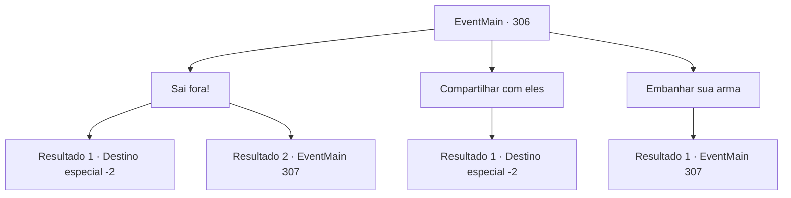

# Eventos principais · 306

[Índice da tabela](index.md) · [Índice geral](../index.md)

ID: `pt:EventMain:306` · Fonte: `EventMain4` · Versão: 1.2.47.

Mapeamento estático dos arquivos; a disponibilidade e a execução dependem do estado da run.

## Texto do evento

*Sem texto no arquivo.*

## Dados de entrada

```json
{
  "id": 306,
  "grade": 1,
  "normalGoal": "",
  "required": ""
}
```

## Mapa das escolhas



## Escolhas e resultados

### Escolha 1

Sai fora!

Requisitos e outros campos da escolha:

```json
{
  "required": ""
}
```

#### Resultado 1.1

Oprimidos por seu comportamento destemido, os aventureiros recuam. Você os intimida, balançando os punhos, e volta para a cidade. Você volta para a cidade e mostra os morcegos mortos ao prefeito. 

 "Obrigada. Você nos prestou um grande serviço. Eu não tenho ideia por que, de repente, há morcegos em todos os lugares, no entanto..."

 Ele sorri calorosamente. Você vê algumas cicatrizes ao redor de seus lábios. Ele então lhe dá o pagamento prometido. Você sai do gabinete do prefeito com uma pequena bolsa de couro cheia de ouro.

Continuação registrada: [Destino especial `-2`](../destinos-especiais.md).

```json
{
  "required": "",
  "chance": "1|0_12_1",
  "nextEvent": -2,
  "type": 0,
  "reward": "0_4_40"
}
```

#### Resultado 1.2

Depois de observar seu comportamento, todos os aventureiros preparam suas armas. 

 "Hmph... Acho que você quer acabar como aquele morcego também."

 Eles se aproximam de você de forma intimidadora. Você não tem escolha a não ser lutar e se proteger.

Continuação registrada: [Evento 307](0307.md) na mesma tabela.

```json
{
  "required": "",
  "chance": "1",
  "nextEvent": 307,
  "type": 1,
  "reward": "6_0_61",
  "place": 6
}
```

### Escolha 2

Compartilhar com eles

Requisitos e outros campos da escolha:

```json
{
  "required": ""
}
```

#### Resultado 2.1

Você voluntariamente entrega aos aventureiros alguns dos morcegos mortos. Eles sorriem, satisfeitos, e enchem suas mochilas com os morcegos mortos. 

 "Hahaha! Agora está falando nossa língua. Vejo você por aí!"

 Os aventureiros decolam, conversando uns com os outros, e você fica olhando para sua mochila vazia.

Continuação registrada: [Destino especial `-2`](../destinos-especiais.md).

```json
{
  "required": "",
  "chance": "1",
  "nextEvent": -2,
  "type": 2,
  "reward": "0_3_1"
}
```

### Escolha 3

Embanhar sua arma

Requisitos e outros campos da escolha:

```json
{
  "required": ""
}
```

#### Resultado 3.1

Em vez de respondê-los, você se prepara para revidar. 

 "Hmph... Acho que você quer acabar como aquele morcego também."

 Eles se aproximam de você de forma intimidadora. Você não tem escolha a não ser lutar e se proteger.

Continuação registrada: [Evento 307](0307.md) na mesma tabela.

```json
{
  "required": "",
  "chance": "1",
  "nextEvent": 307,
  "type": 2,
  "reward": "6_0_61",
  "place": 6
}
```

## Referências que chegam a este evento

- [Evento 305 · escolha 1 · resultado 1](0305.md#escolha-1)
