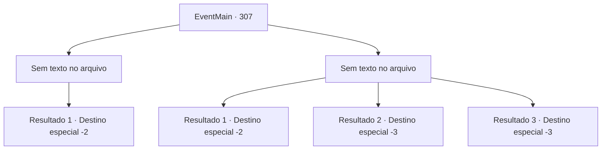

# Eventos principais · 307

[Índice da tabela](index.md) · [Índice geral](../index.md)

ID: `pt:EventMain:307` · Fonte: `EventMain4` · Versão: 1.2.47.

Mapeamento estático dos arquivos; a disponibilidade e a execução dependem do estado da run.

## Texto do evento

*Sem texto no arquivo.*

## Dados de entrada

```json
{
  "id": 307,
  "grade": 1,
  "normalGoal": "",
  "required": ""
}
```

## Mapa das escolhas



## Escolhas e resultados

### Escolha 1

*Sem texto no arquivo; o papel dessa opção depende da interface do jogo.*

Requisitos e outros campos da escolha:

```json
{
  "required": ""
}
```

#### Resultado 1.1

Você desce o cacete nos aventureiros. Se aproximando, você saqueia os cadáveres de morcegos que eles reuniram. Você volta para a cidade e mostra os morcegos mortos ao prefeito. 

 "Obrigada. Você nos prestou um grande serviço. Eu não tenho ideia por que, de repente, há morcegos em todos os lugares, no entanto..."

 Ele sorri calorosamente. Você vê algumas cicatrizes ao redor de seus lábios. Ele então lhe dá o pagamento prometido. Você sai do gabinete do prefeito com uma pequena bolsa de couro cheia de ouro.

Continuação registrada: [Destino especial `-2`](../destinos-especiais.md).

```json
{
  "required": "",
  "chance": "1",
  "nextEvent": -2,
  "type": 2,
  "reward": "0_4_80"
}
```

### Escolha 2

*Sem texto no arquivo; o papel dessa opção depende da interface do jogo.*

Requisitos e outros campos da escolha:

```json
{
  "required": ""
}
```

#### Resultado 2.1

Os aventureiros são demais para você, tiram os morcegos mortos, e sua futura recompensa, de você. 

 "Nós lhe demos uma chance, não foi? Você poderia ter ouvido."

 Eles zombam de você antes de decolar. Você se deita no chão por um tempo para se curar e pega sua mochila vazia.

Continuação registrada: [Destino especial `-2`](../destinos-especiais.md).

```json
{
  "required": "1_0_2|1_1_2",
  "chance": "1",
  "nextEvent": -2,
  "type": 2,
  "reward": "0_0_-1|0_1_-1"
}
```

#### Resultado 2.2

Os aventureiros são demais para você, tiram os morcegos mortos, e sua futura recompensa, de você. Alguns deles começam a falar, olhando para você no chão. 

 "Ei... Ele não tá... morto?"

 Eles correm para fora da caverna, deixando apenas o seu corpo, agora frio.

Continuação registrada: [Destino especial `-3`](../destinos-especiais.md).

```json
{
  "required": "2_0_2",
  "chance": "1",
  "nextEvent": -3,
  "type": 2,
  "reward": "0_0_-1|0_1_-1"
}
```

#### Resultado 2.3

Os aventureiros são demais para você, tiram os morcegos mortos, e sua futura recompensa, de você. Alguns deles começam a falar, olhando para você no chão. 

 "Ei... Ele não tá... morto?"

 Eles correm para fora da caverna, deixando apenas o seu corpo, agora frio.

Continuação registrada: [Destino especial `-3`](../destinos-especiais.md).

```json
{
  "required": "2_1_2",
  "chance": "1",
  "nextEvent": -3,
  "type": 2,
  "reward": "0_0_-1|0_1_-1"
}
```

## Referências que chegam a este evento

- [Evento 306 · escolha 1 · resultado 2](0306.md#escolha-1)
- [Evento 306 · escolha 3 · resultado 1](0306.md#escolha-3)
