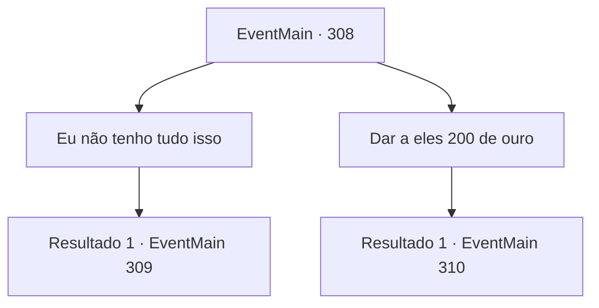

# Eventos principais · 308

[Índice da tabela](index.md) · [Índice geral](../index.md)

ID: `pt:EventMain:308` · Fonte: `EventMain4` · Versão: 1.2.47.

Mapeamento estático dos arquivos; a disponibilidade e a execução dependem do estado da run.

## Texto do evento

Você não tem ideia de como, mas os subordinados de Anton encontraram você. 

 "A quanto tempo, não é, {1}. Espero que você tenha conseguido se alimentar, hein?"

 Eles disseram que você é apenas um novato no ramo de aventureiros, então só estão pedindo 200 de ouro. 

## Dados de entrada

```json
{
  "id": 308,
  "grade": 1,
  "normalGoal": "",
  "required": "13_3_1|1_2_5"
}
```

## Mapa das escolhas



## Escolhas e resultados

### Escolha 1

Eu não tenho tudo isso

Requisitos e outros campos da escolha:

```json
{
  "required": ""
}
```

#### Resultado 1.1

Você não tem tanto ouro. Um dos homens de Anton coça a parte de trás de sua cabeça, seu rosto lentamente se transformando em uma carranca estressante. 

 "Hm.. Acho que não há outro jeito, então. Teremos que tirar um pouco do nosso... seguro."


Continuação registrada: [Evento 309](0309.md) na mesma tabela.

```json
{
  "required": "",
  "chance": "1",
  "nextEvent": 309,
  "type": 2,
  "reward": ""
}
```

### Escolha 2

Dar a eles 200 de ouro

Requisitos e outros campos da escolha:

```json
{
  "required": "1_4_200"
}
```

#### Resultado 2.1

Depois de receber o ouro, o líder dos homens de Anton começa a contar. 

 "Agradecemos por uma operação bem feita, {1}. Haha. Ah certo, eu vou te dar um pequeno conselho. Certifique-se de pagar o ouro de volta a tempo. Tanto para você quanto para seu irmãozinho. De verdade."

 Ele toca em suas bochechas e sorri. Ele então acena para você, indo embora. Você vai para uma taverna próxima, para aliviar um pouco a tensão.

Continuação registrada: [Evento 310](0310.md) na mesma tabela.

```json
{
  "required": "",
  "chance": "1",
  "nextEvent": 310,
  "type": 2,
  "reward": "0_4_-200"
}
```

## Referências que chegam a este evento

Nenhum `nextEvent` positivo da mesma tabela aponta para este nó. Isso não prova que seja inacessível: sorteio e estado de história podem selecioná-lo.

