# Eventos principais · 309

[Índice da tabela](index.md) · [Índice geral](../index.md)

ID: `pt:EventMain:309` · Fonte: `EventMain4` · Versão: 1.2.47.

Mapeamento estático dos arquivos; a disponibilidade e a execução dependem do estado da run.

## Texto do evento

*Sem texto no arquivo.*

## Dados de entrada

```json
{
  "id": 309,
  "grade": 1,
  "normalGoal": "",
  "required": ""
}
```

## Mapa das escolhas

```mermaid
flowchart TD
  E["EventMain · 309"]
  C0["... Do &#x27;seguro&#x27;?"]
  E --> C0
  R0_0["Resultado 1 · EventMain 309"]
  C0 --> R0_0
  C1["Por favor, tenham piedade"]
  E --> C1
  R1_0["Resultado 1 · EventMain 310"]
  C1 --> R1_0
  C2["Não. Toque. Na. Minha irmã."]
  E --> C2
  R2_0["Resultado 1 · EventMain 310"]
  C2 --> R2_0
```



## Escolhas e resultados

### Escolha 1

... Do 'seguro'? 

Requisitos e outros campos da escolha:

```json
{
  "required": "5_243_0"
}
```

#### Resultado 1.1

Ele responde sua pergunta de uma maneira maliciosa. 

 "Sim. Se não puder pagar de volta, teremos que tomá-lo do seu irmão. Não se preocupe, no entanto. Seremos muito... gentis."


Continuação registrada: [Evento 309](0309.md) na mesma tabela.

```json
{
  "required": "",
  "chance": "1",
  "nextEvent": 309,
  "type": 2,
  "reward": "5_243_1"
}
```

### Escolha 2

Por favor, tenham piedade

Requisitos e outros campos da escolha:

```json
{
  "required": ""
}
```

#### Resultado 2.1

Você implorou a eles para lhe dar uma última chance. Mas tudo o que eles fazem é rir do seu comportamento. 

 "Espero que da próxima vez que nos encontrarmos, você tenha algum ouro pronto."

 Um deles bate em suas bochechas e sorri. Ele então acena para você, indo embora. Você vai para uma taverna próxima, para aliviar um pouco a tensão.

Continuação registrada: [Evento 310](0310.md) na mesma tabela.

```json
{
  "required": "",
  "chance": "1",
  "nextEvent": 310,
  "type": 2,
  "reward": "5_244_1"
}
```

### Escolha 3

Não. Toque. Na. Minha irmã.

Requisitos e outros campos da escolha:

```json
{
  "required": ""
}
```

#### Resultado 3.1

Você grita com eles, ameaçando matá-los se eles colocarem um dedo em seu irmão. Mas tudo o que eles fazem é rir do seu comportamento. 

 "Espero que da próxima vez que nos encontrarmos, você tenha algum ouro pronto."

 Um deles bate em suas bochechas e sorri. Ele então acena para você, indo embora. Você vai para uma taverna próxima, para aliviar um pouco a tensão.

Continuação registrada: [Evento 310](0310.md) na mesma tabela.

```json
{
  "required": "",
  "chance": "1",
  "nextEvent": 310,
  "type": 2,
  "reward": "5_244_1"
}
```

## Referências que chegam a este evento

- [Evento 308 · escolha 1 · resultado 1](0308.md#escolha-1)
- [Evento 309 · escolha 1 · resultado 1](0309.md#escolha-1)
