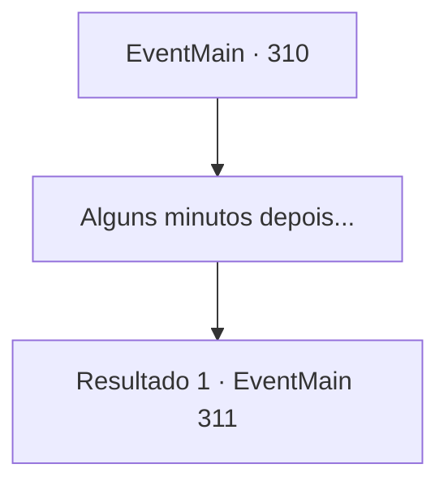

# Eventos principais · 310

[Índice da tabela](index.md) · [Índice geral](../index.md)

ID: `pt:EventMain:310` · Fonte: `EventMain4` · Versão: 1.2.47.

Mapeamento estático dos arquivos; a disponibilidade e a execução dependem do estado da run.

## Texto do evento

*Sem texto no arquivo.*

## Dados de entrada

```json
{
  "id": 310,
  "grade": 1,
  "normalGoal": "",
  "required": ""
}
```

## Mapa das escolhas



## Escolhas e resultados

### Escolha 1

Alguns minutos depois...

Requisitos e outros campos da escolha:

```json
{
  "required": ""
}
```

#### Resultado 1.1

Você se senta em uma das mesas e engole um copo de água fria. Você se acalmou um pouco, mas suas mãos ainda tremem de ressentimento. Então, um grupo de homens armados equipados com armaduras de prata brilhante entra na taverna. Você os examina rapidamente com os olhos. Suas espadas, armaduras, escudos e até suas bestas... Você percebe que são todos feitos de prata. |drawing_vampHunters| Eles pegam uma das mesas vazias, pedem comida, rezam e começam a conversar.

Continuação registrada: [Evento 311](0311.md) na mesma tabela.

```json
{
  "required": "",
  "chance": "1",
  "nextEvent": 311,
  "type": 2,
  "reward": ""
}
```

## Referências que chegam a este evento

- [Evento 308 · escolha 2 · resultado 1](0308.md#escolha-2)
- [Evento 309 · escolha 2 · resultado 1](0309.md#escolha-2)
- [Evento 309 · escolha 3 · resultado 1](0309.md#escolha-3)
