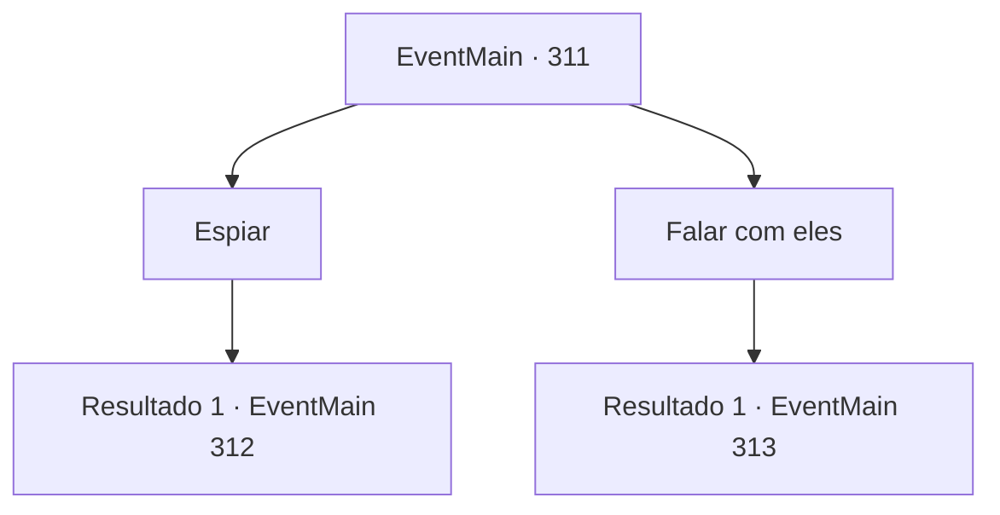

# Eventos principais · 311

[Índice da tabela](index.md) · [Índice geral](../index.md)

ID: `pt:EventMain:311` · Fonte: `EventMain4` · Versão: 1.2.47.

Mapeamento estático dos arquivos; a disponibilidade e a execução dependem do estado da run.

## Texto do evento

*Sem texto no arquivo.*

## Dados de entrada

```json
{
  "id": 311,
  "grade": 1,
  "normalGoal": "",
  "required": ""
}
```

## Mapa das escolhas



## Escolhas e resultados

### Escolha 1

Espiar

Requisitos e outros campos da escolha:

```json
{
  "required": ""
}
```

#### Resultado 1.1

Aparentemente, eles estão falando sobre uma caçada recente. 

 "Nós estávamos tão perto..."

 "Eu sinto Muito. Eu não prestei atenção lá atrás... eu nem percebi que estava sem dardos de prata. Peço desculpas."

 "Não há necessidade disso, senhor. Vamos pegar aquele vampiro."

 Parece que seu alvo é um vampiro. Eles estão discutindo sobre como caçá-lo.

Continuação registrada: [Evento 312](0312.md) na mesma tabela.

```json
{
  "required": "",
  "chance": "1",
  "nextEvent": 312,
  "type": 2,
  "reward": ""
}
```

### Escolha 2

Falar com eles

Requisitos e outros campos da escolha:

```json
{
  "required": ""
}
```

#### Resultado 2.1

Atordoado com a presença deles, você nem percebe que está se aproximando deles com admiração. Ao vê-lo, eles abrem um sorriso confiante e se apresentam. 

 "Ah, saudações. Somos membros dos 'Mercenários Ziwa'. Não lidamos com monstros ou humanos comuns. Somos caçadores de vampiros, treinados especificamente para capturar e matar os malditos sugadores de sangue."


Continuação registrada: [Evento 313](0313.md) na mesma tabela.

```json
{
  "required": "",
  "chance": "1",
  "nextEvent": 313,
  "type": 2,
  "reward": ""
}
```

## Referências que chegam a este evento

- [Evento 310 · escolha 1 · resultado 1](0310.md#escolha-1)
