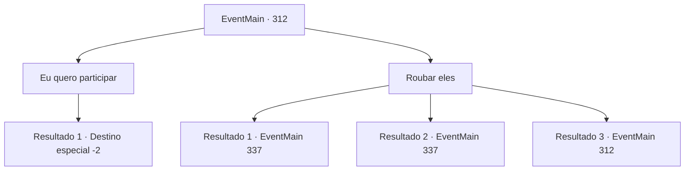

# Eventos principais · 312

[Índice da tabela](index.md) · [Índice geral](../index.md)

ID: `pt:EventMain:312` · Fonte: `EventMain4` · Versão: 1.2.47.

Mapeamento estático dos arquivos; a disponibilidade e a execução dependem do estado da run.

## Texto do evento

*Sem texto no arquivo.*

## Dados de entrada

```json
{
  "id": 312,
  "grade": 1,
  "normalGoal": "",
  "required": ""
}
```

## Mapa das escolhas



## Escolhas e resultados

### Escolha 1

Eu quero participar

Requisitos e outros campos da escolha:

```json
{
  "required": ""
}
```

#### Resultado 1.1

Movido pelo brilho reluzente de seus equipamentos caros, você diz a eles que gostaria de se juntar à caça aos vampiros. Ouvindo seu pedido, os caçadores se voltam e conversam entre si. Aquele com a barba longa responde a você. 

 "Não tenho certeza se você já ouviu falar de nós antes ou não, mas somos membros dos 'Ziwa Mercenaries'. Somos caçadores de vampiros, treinados especificamente para capturar e matar os malditos sugadores de sangue. Eu aprecio sua ajuda. Não recebemos esse tipo de oferta com frequência."

 Ele sorri calorosamente e estende a mão para um aperto de mão. Ao alcançar o aperto de mão, você sente uma dor aguda na palma da mão. Você vê uma gota de sangue em sua mão. 

 "Desculpas. Um procedimento simples para se certificar de que você não é um deles. Aceitaremos com prazer sua ajuda. Mas agora não é o momento certo. Quando nossos preparativos estiverem concluídos, faremos questão de ligar para você."

 Você e os caçadores de vampiros decidem quando se encontrar e saem da taverna.

Continuação registrada: [Destino especial `-2`](../destinos-especiais.md).

```json
{
  "required": "",
  "chance": "1",
  "nextEvent": -2,
  "type": 2,
  "reward": "13_3_2|0_2_1"
}
```

### Escolha 2

Roubar eles

Requisitos e outros campos da escolha:

```json
{
  "required": "5_245_0"
}
```

#### Resultado 2.1

Você decide roubar suas armas de aparência valiosa enquanto sua atenção está fixa em outra coisa. Você os observa silenciosamente, esperando por uma boa oportunidade.  Eles estão bebendo cerveja, fazendo planos para pegar a presa que supostamente perderam.  Você chegou bem perto da mesa deles, mas eles parecem não perceber sua presença.

Continuação registrada: [Evento 337](0337.md) na mesma tabela.

```json
{
  "required": "",
  "chance": "1|0_6_1",
  "nextEvent": 337,
  "type": 0,
  "reward": ""
}
```

#### Resultado 2.2

Você decide roubar suas armas de aparência valiosa enquanto sua atenção está fixa em outra coisa. Você os observa silenciosamente, esperando por uma boa oportunidade.  Eles estão bebendo cerveja, fazendo planos para pegar a presa que supostamente perderam.  Você chegou bem perto da mesa deles, mas eles parecem não perceber sua presença.

Continuação registrada: [Evento 337](0337.md) na mesma tabela.

```json
{
  "required": "20_5_1",
  "chance": "1|0_6_1",
  "nextEvent": 337,
  "type": 0,
  "reward": ""
}
```

#### Resultado 2.3

Você decide furtar os equipamentes reluzentes dos guerreiros. Você os observa silenciosamente, esperando por uma boa oportunidade. Eles estão bebendo cerveja, fazendo planos para pegar a presa que supostamente perderam. Você chegou bem perto da mesa deles. Infelizmente, eles parecem ter notado você se aproximando deles. 

 "..Podemos ajuda-lo?"

 Uma mulher de cabelo azul olha para você com desconfiança.

Continuação registrada: [Evento 312](0312.md) na mesma tabela.

```json
{
  "required": "",
  "chance": "18",
  "nextEvent": 312,
  "type": 1,
  "reward": "5_245_1"
}
```

## Referências que chegam a este evento

- [Evento 311 · escolha 1 · resultado 1](0311.md#escolha-1)
- [Evento 312 · escolha 2 · resultado 3](0312.md#escolha-2)
