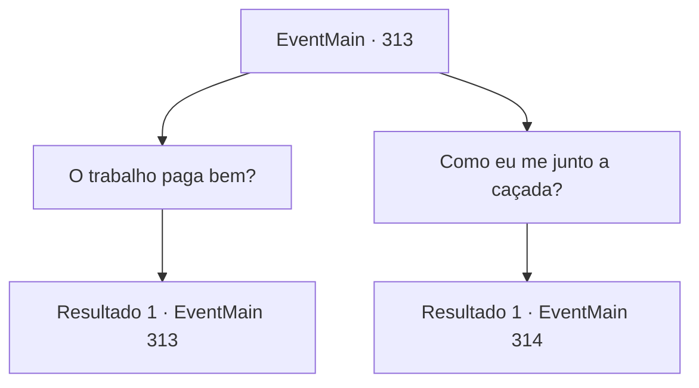

# Eventos principais · 313

[Índice da tabela](index.md) · [Índice geral](../index.md)

ID: `pt:EventMain:313` · Fonte: `EventMain4` · Versão: 1.2.47.

Mapeamento estático dos arquivos; a disponibilidade e a execução dependem do estado da run.

## Texto do evento

*Sem texto no arquivo.*

## Dados de entrada

```json
{
  "id": 313,
  "grade": 1,
  "normalGoal": "",
  "required": ""
}
```

## Mapa das escolhas



## Escolhas e resultados

### Escolha 1

O trabalho paga bem?

Requisitos e outros campos da escolha:

```json
{
  "required": "5_246_0"
}
```

#### Resultado 1.1

O barbudo responde, apontando para seu equipamento. 

 "Vamos ver... Você se junta às nossas fileiras, treina um pouco, completa algumas caçadas e... Eu diria que cerca de meio ano e você poderá comprar cinco cavalos. Isso vai ser... 2.000 de ouro, mais ou menos. Claro, isso se você for tão bom quanto nós! Ahahaha!!"

 Você assume que a arrogância tem seus fundamentos.

Continuação registrada: [Evento 313](0313.md) na mesma tabela.

```json
{
  "required": "",
  "chance": "1",
  "nextEvent": 313,
  "type": 2,
  "reward": "5_246_1"
}
```

### Escolha 2

Como eu me junto a caçada?

Requisitos e outros campos da escolha:

```json
{
  "required": ""
}
```

#### Resultado 2.1

Você pergunta a eles como alguém pode se tornar um caçador de vampiros. Uma senhora de cabelo azul responde a você. 

 "Hum.. nos ajude com nossa caçada. Em seguida, escreveremos uma carta de recomendação."


Continuação registrada: [Evento 314](0314.md) na mesma tabela.

```json
{
  "required": "",
  "chance": "1",
  "nextEvent": 314,
  "type": 2,
  "reward": ""
}
```

## Referências que chegam a este evento

- [Evento 311 · escolha 2 · resultado 1](0311.md#escolha-2)
- [Evento 313 · escolha 1 · resultado 1](0313.md#escolha-1)
