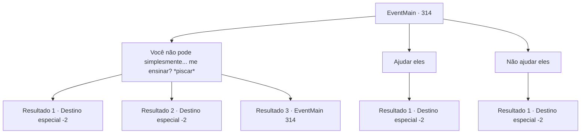

# Eventos principais · 314

[Índice da tabela](index.md) · [Índice geral](../index.md)

ID: `pt:EventMain:314` · Fonte: `EventMain4` · Versão: 1.2.47.

Mapeamento estático dos arquivos; a disponibilidade e a execução dependem do estado da run.

## Texto do evento

*Sem texto no arquivo.*

## Dados de entrada

```json
{
  "id": 314,
  "grade": 1,
  "normalGoal": "",
  "required": ""
}
```

## Mapa das escolhas



## Escolhas e resultados

### Escolha 1

Você não pode simplesmente... me ensinar? *piscar* 

Requisitos e outros campos da escolha:

```json
{
  "required": "5_247_0"
}
```

#### Resultado 1.1

Você pisca para eles e pergunta com uma voz travessa. Um homem usando um tapa-olho direito reclama sarcasticamente. 

 "Jovem aventureiro, essa não é a abordagem correta ao tentar comprar informações..."

 Mas antes que ele possa terminar, a senhora de cabelo azul cora e abre a boca. 

 "Vá... para... Ilha de Illaha. Aqui, sua carta de recomendação."

 "Que diabos está fazendo??"

 Ignorando os dois homens perplexos, a senhora lhe entrega a carta de recomendação. Você agradece a ela e segue em direção à sede dos 'Ziwa Mercenaries', localizada na Ilha Illaha.

Continuação registrada: [Destino especial `-2`](../destinos-especiais.md).

```json
{
  "required": "11_0_0",
  "chance": "1|0_12_1",
  "nextEvent": -2,
  "type": 0,
  "reward": "13_3_5|3_226_1|0_2_1"
}
```

#### Resultado 1.2

Você pisca para eles e pergunta com uma voz travessa. Então, o barbudo cai na gargalhada e lhe entrega a carta de recomendação. 

 "Kyahahaha! Vá para a Ilha Illaha! Aqui, sua carta de recomendação."

 "????"

 A senhora de cabelo azul olha para o homem barbudo e outro homem com tapa-olho. Mas os dois homens silenciosamente acenam com a cabeça. 

 "Ah, homens..."

 Você pega a carta de recomendação. Você agradece aos caçadores e depois segue em direção à sede dos 'Ziwa Mercenaries', localizada na Ilha Illaha.

Continuação registrada: [Destino especial `-2`](../destinos-especiais.md).

```json
{
  "required": "11_0_1",
  "chance": "1|0_12_1",
  "nextEvent": -2,
  "type": 0,
  "reward": "13_3_5|3_226_1|0_2_1"
}
```

#### Resultado 1.3

Você pisca para eles e pergunta com uma voz travessa. Mas tudo o que ela faz é repetir o que acabou de dizer em uma voz sem emoção. 

 "Você nos ajuda, nós escreveremos uma carta de recomendação. É pegar ou largar."


Continuação registrada: [Evento 314](0314.md) na mesma tabela.

```json
{
  "required": "",
  "chance": "15",
  "nextEvent": 314,
  "type": 1,
  "reward": "5_247_1"
}
```

### Escolha 2

Ajudar eles

Requisitos e outros campos da escolha:

```json
{
  "required": ""
}
```

#### Resultado 2.1

Você decide ajudar os caçadores de vampiros em sua caçada. A julgar por suas armas, os caçadores de vampiros ganham muito ouro. Você gostaria disso. 

 "Agradecemos sua ajuda."

 O homem barbudo sorri calorosamente e estende a mão para um aperto de mão. Ao alcançar o aperto de mão, você sente uma dor aguda na palma da mão. Você vê uma gota de sangue em sua mão. 

 "Desculpas. Um procedimento simples para se certificar de que você não é um deles. Aceitaremos com prazer sua ajuda. Mas agora não é o momento certo. Quando nossos preparativos estiverem concluídos, faremos questão de ligar para você."

 Você e os caçadores de vampiros decidem quando se encontrarão e você sai

Continuação registrada: [Destino especial `-2`](../destinos-especiais.md).

```json
{
  "required": "",
  "chance": "1",
  "nextEvent": -2,
  "type": 2,
  "reward": "13_3_2|0_2_1"
}
```

### Escolha 3

Não ajudar eles

Requisitos e outros campos da escolha:

```json
{
  "required": ""
}
```

#### Resultado 3.1

Você diz a eles que encontrará os 'Mercenários de Ziwa' por conta própria. Você sai da taverna.

Continuação registrada: [Destino especial `-2`](../destinos-especiais.md).

```json
{
  "required": "",
  "chance": "1",
  "nextEvent": -2,
  "type": 2,
  "reward": "13_3_6|0_2_1"
}
```

## Referências que chegam a este evento

- [Evento 313 · escolha 2 · resultado 1](0313.md#escolha-2)
- [Evento 314 · escolha 1 · resultado 3](0314.md#escolha-1)
