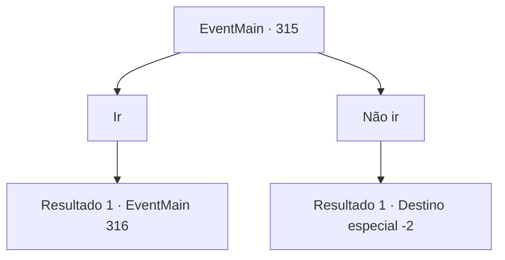

# Eventos principais · 315

[Índice da tabela](index.md) · [Índice geral](../index.md)

ID: `pt:EventMain:315` · Fonte: `EventMain4` · Versão: 1.2.47.

Mapeamento estático dos arquivos; a disponibilidade e a execução dependem do estado da run.

## Texto do evento

Com o som de asas batendo, um pombo mensageiro se aproxima de você. O pombo branco tem um pequeno pedaço de papel amarrado ao tornozelo. Ao abri-lo, você reconhece o brasão de 'Ziwa Mercenaries'. Esta deve ser uma mensagem dos caçadores de vampiros que você conheceu da última vez.
 — Em quatro dias, na Floresta Caripps. 21h, em ponto.

## Dados de entrada

```json
{
  "id": 315,
  "grade": 1,
  "normalGoal": "",
  "required": "13_3_2|1_2_15"
}
```

## Mapa das escolhas



## Escolhas e resultados

### Escolha 1

Ir

Requisitos e outros campos da escolha:

```json
{
  "required": ""
}
```

#### Resultado 1.1

Você vai para a Floresta de Caripps, para cumprir sua promessa com os caçadores de vampiros. 

 Três dias se passaram e o sol está prestes a se pôr. A escuridão chega. Você se encontra com os caçadores em uma clareira perto de Caripps Woods. O caçador barbudo cumprimenta você calorosamente. 

 "Nós nem nos apresentamos. Bom te conhecer. Meu nome é 'Alfons'. O tapa-olho lá é chamado de 'François', e a azul aqui é 'Yan'."

 Os caçadores levantam as mãos, cumprimentando você. 

 "Sua missão esta noite é vagar por esses bosques. Temos certeza de que há um vampiro escondido aqui. Você é nossa isca, por assim dizer."

 Como os caçadores pediram, você começa a andar sozinho pela floresta escura. 

 Depois de andar por quem sabe quanto tempo, não há sinal de vampiro, ou qualquer outra coisa. Você está exausto de toda a caminhada. Então, você encontra um toco para sentar e descansar. Então, uma mulher aparece da floresta. 

 "Ah... o que você... está fazendo sozinho... na floresta numa hora dessas?"

 Ela lhe dá um olhar muito sugestivo e caminha em sua direção.

Continuação registrada: [Evento 316](0316.md) na mesma tabela.

```json
{
  "required": "",
  "chance": "1",
  "nextEvent": 316,
  "type": 2,
  "reward": ""
}
```

### Escolha 2

Não ir

Requisitos e outros campos da escolha:

```json
{
  "required": ""
}
```

#### Resultado 2.1

Você joga fora a carta e decide encontrar os 'Mercenários de Ziwa' por conta própria.

Continuação registrada: [Destino especial `-2`](../destinos-especiais.md).

```json
{
  "required": "",
  "chance": "1",
  "nextEvent": -2,
  "type": 2,
  "reward": "13_3_6|0_2_1"
}
```

## Referências que chegam a este evento

Nenhum `nextEvent` positivo da mesma tabela aponta para este nó. Isso não prova que seja inacessível: sorteio e estado de história podem selecioná-lo.

