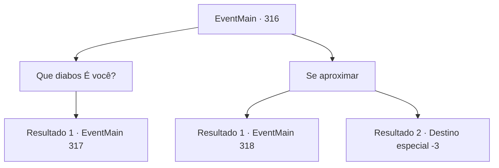

# Eventos principais · 316

[Índice da tabela](index.md) · [Índice geral](../index.md)

ID: `pt:EventMain:316` · Fonte: `EventMain4` · Versão: 1.2.47.

Mapeamento estático dos arquivos; a disponibilidade e a execução dependem do estado da run.

## Texto do evento

*Sem texto no arquivo.*

## Dados de entrada

```json
{
  "id": 316,
  "grade": 1,
  "normalGoal": "",
  "required": ""
}
```

## Mapa das escolhas



## Escolhas e resultados

### Escolha 1

Que diabos É você?

Requisitos e outros campos da escolha:

```json
{
  "required": "1_14_15"
}
```

#### Resultado 1.1

Você sente como se o olhar dela estivesse segurando e sacudindo sua mente. É realmente desagradável. Você balança a cabeça e pergunta o que ela realmente é. Depois de ouvir isso, seus olhos encantadores se transformam em um olhar mortal. 

 "Ugh, é exatamente por isso que eu odeio crianças inteligentes..."

 Assim que ela termina de falar, seus olhos brilhantes voam na sua direção. 

Continuação registrada: [Evento 317](0317.md) na mesma tabela.

```json
{
  "required": "",
  "chance": "1",
  "nextEvent": 317,
  "type": 2,
  "reward": "6_0_123",
  "place": 1
}
```

### Escolha 2

Se aproximar

Requisitos e outros campos da escolha:

```json
{
  "required": "2_14_15"
}
```

#### Resultado 2.1

Você está completamente encantado com o olhar dela. Sem nem perceber, você caminha em direção a ela. Então, suas mãos frias deslizam para baixo, cruzando seu rosto e pousando em seus ombros. Um par de dentes afiados afunda em seu pescoço. Você logo percebe o que está acontecendo. Você reúne todas as suas forças para afastá-la, mas ela aperta seu aperto em você com uma força incrível, drenando seu sangue cada vez mais. É nesse momento que um raio de prata vem voando da escuridão, perfurando a cabeça da mulher. |drawing_ashenVamp| Seu corpo inteiro queima, terminando como uma pilha de cinzas. Os caçadores de vampiros correm rapidamente para você e verificam seus ferimentos. Eles apressadamente colocaram as cinzas dentro de uma bolsa. 

 "Bem feito. Vamos voltar para a igreja."

 O caçador com o tapa-olho ajuda você a se levantar.

Continuação registrada: [Evento 318](0318.md) na mesma tabela.

```json
{
  "required": "1_0_2",
  "chance": "1",
  "nextEvent": 318,
  "type": 2,
  "reward": "0_0_-1|5_248_1"
}
```

#### Resultado 2.2

Você está completamente encantado com o olhar dela. Sem nem perceber, você caminha em direção a ela. Então, suas mãos frias deslizam para baixo, cruzando seu rosto e pousando em seus ombros. Um par de dentes afiados afunda em seu pescoço. Você logo percebe o que está acontecendo. Você reúne todas as suas forças para afastá-la, mas ela aperta seu aperto em você com uma força incrível, drenando seu sangue cada vez mais. Você perde a consciência e entra em colapso.

Continuação registrada: [Destino especial `-3`](../destinos-especiais.md).

```json
{
  "required": "2_0_2",
  "chance": "1",
  "nextEvent": -3,
  "type": 2,
  "reward": "0_0_-1"
}
```

## Referências que chegam a este evento

- [Evento 315 · escolha 1 · resultado 1](0315.md#escolha-1)
