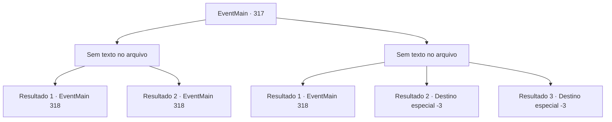

# Eventos principais · 317

[Índice da tabela](index.md) · [Índice geral](../index.md)

ID: `pt:EventMain:317` · Fonte: `EventMain4` · Versão: 1.2.47.

Mapeamento estático dos arquivos; a disponibilidade e a execução dependem do estado da run.

## Texto do evento

*Sem texto no arquivo.*

## Dados de entrada

```json
{
  "id": 317,
  "grade": 1,
  "normalGoal": "",
  "required": ""
}
```

## Mapa das escolhas



## Escolhas e resultados

### Escolha 1

*Sem texto no arquivo; o papel dessa opção depende da interface do jogo.*

Requisitos e outros campos da escolha:

```json
{
  "required": ""
}
```

#### Resultado 1.1

Você derrota o vampiro. Mas ele lentamente começa a se levantar, contorcendo seu corpo de maneira grotesca. Ele ataca você novamente. Mas então, um raio de prata vem voando da escuridão e perfura a cabeça do vampiro. |drawing_ashenVamp| Seu corpo inteiro queima, terminando como uma pilha de cinzas. Os caçadores de vampiros correm rapidamente para você e verificam seus ferimentos. Eles apressadamente colocaram as cinzas dentro de uma bolsa. 

 "Bom trabalho. Vejo que você é um lutador capaz. Temos o que viemos, vamos voltar para a igreja. Hora de receber nosso pagamento."


Continuação registrada: [Evento 318](0318.md) na mesma tabela.

```json
{
  "required": "24_2_1",
  "chance": "1",
  "nextEvent": 318,
  "type": 2,
  "reward": ""
}
```

#### Resultado 1.2

|drawing_ashenVamp| Você derrota a vampira, e ela instantaneamente se transforma em uma pilha de cinzas. Os caçadores de vampiros correm rapidamente para você e verificam seus ferimentos. Eles apressadamente colocaram as cinzas dentro de uma bolsa. 

 "Uau, lutar sozinho contra um desses e vencer... Vamos voltar para a igreja. Hora de receber nosso pagamento."


Continuação registrada: [Evento 318](0318.md) na mesma tabela.

```json
{
  "required": "23_2_1",
  "chance": "1",
  "nextEvent": 318,
  "type": 2,
  "reward": "5_248_2"
}
```

### Escolha 2

*Sem texto no arquivo; o papel dessa opção depende da interface do jogo.*

Requisitos e outros campos da escolha:

```json
{
  "required": ""
}
```

#### Resultado 2.1

Você luta contra o aperto do vampiro, mas não adianta. Suas mãos frias pousam em seu rosto. A força dele é imensa, seus dentes parecem afundar cada vez mais em seu pescoço. Conforme você sente o sangue sendo drenado de suas veias, um raio prateado vem voando da escuridão e perfura a cabeça do vampiro. |drawing_ashenVamp| Seu corpo inteiro queima, terminando como uma pilha de cinzas. Os caçadores de vampiros correm rapidamente para você e verificam seus ferimentos. Eles apressadamente colocaram as cinzas dentro de uma bolsa. 

 "Bem feito. Vamos voltar para a igreja."

 O caçador com o tapa-olho ajuda você a se levantar. 

Continuação registrada: [Evento 318](0318.md) na mesma tabela.

```json
{
  "required": "1_0_2|1_1_2",
  "chance": "1",
  "nextEvent": 318,
  "type": 2,
  "reward": "0_0_-1|5_248_1"
}
```

#### Resultado 2.2

Você reage contra o vampiro, mas não adianta. Suas mãos frias pousam em seu rosto. Sua força é imensa e seus dentes cravam cada vez mais fundo no seu pescoço. Você perde a consciência ao sentir o sangue sendo drenado de suas veias.

Continuação registrada: [Destino especial `-3`](../destinos-especiais.md).

```json
{
  "required": "2_0_2",
  "chance": "1",
  "nextEvent": -3,
  "type": 2,
  "reward": "0_0_-1|0_1_-1"
}
```

#### Resultado 2.3

Você reage contra o vampiro, mas não adianta. Suas mãos frias pousam em seu rosto. Sua força é imensa e seus dentes cravam cada vez mais fundo no seu pescoço. Você perde a consciência ao sentir o sangue sendo drenado de suas veias.

Continuação registrada: [Destino especial `-3`](../destinos-especiais.md).

```json
{
  "required": "2_1_2",
  "chance": "1",
  "nextEvent": -3,
  "type": 2,
  "reward": "0_0_-1|0_1_-1"
}
```

## Referências que chegam a este evento

- [Evento 316 · escolha 1 · resultado 1](0316.md#escolha-1)
