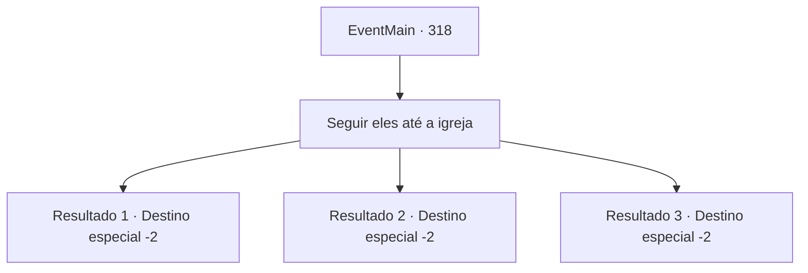

# Eventos principais · 318

[Índice da tabela](index.md) · [Índice geral](../index.md)

ID: `pt:EventMain:318` · Fonte: `EventMain4` · Versão: 1.2.47.

Mapeamento estático dos arquivos; a disponibilidade e a execução dependem do estado da run.

## Texto do evento

*Sem texto no arquivo.*

## Dados de entrada

```json
{
  "id": 318,
  "grade": 1,
  "normalGoal": "",
  "required": ""
}
```

## Mapa das escolhas



## Escolhas e resultados

### Escolha 1

Seguir eles até a igreja

Requisitos e outros campos da escolha:

```json
{
  "required": ""
}
```

#### Resultado 1.1

Você chega a uma cidade chamada 'Gleesee', seguindo os caçadores de vampiros até a igreja local. Os caçadores entregam a bolsa cheia de cinzas de vampiro ao padre. 

 "Hm... estas são cinzas genuínas de vampiros. Um trabalho bem feito."

 O padre paga os caçadores. Eles compartilham com você uma parte do pagamento. Além disso, eles entregam uma carta de recomendação conforme prometido. 

 "Leve isso para a 'Ilha de Illaha'. Nossa sede é logo ali. Mostre-lhes a carta e eles vão recebê-lo como uma família."

 Então os caçadores vão embora, desejando-lhe sorte em suas aventuras.

Continuação registrada: [Destino especial `-2`](../destinos-especiais.md).

```json
{
  "required": "5_248_0",
  "chance": "1",
  "nextEvent": -2,
  "type": 2,
  "reward": "0_4_50|13_3_5|3_226_1|0_2_1"
}
```

#### Resultado 1.2

Você chega a uma cidade chamada 'Gleesee', seguindo os caçadores de vampiros até a igreja local. A primeira coisa que os caçadores fazem é mostrar ao padre o quanto você está ferido, pedindo a cura. 

 "Siga-me por favor."

 O padre enche uma tigela de prata com água, lavando suas feridas com ela. Assim que a água toca as feridas, você percebe muitas bolhas criadas em suas feridas, embora elas desapareçam relativamente rápido. Somente depois que seus ferimentos foram completamente enfaixados, os caçadores entregam as cinzas do vampiro ao padre. 

 "Hm... estas são cinzas genuínas de vampiros. Um trabalho bem feito."

 O padre paga os caçadores. Eles compartilham com você uma parte do pagamento. Além disso, eles entregam uma carta de recomendação conforme prometido. 

 "Leve isso para a 'Ilha de Illaha'. Nossa sede é logo ali. Mostre-lhes a carta e eles vão recebê-lo como uma família."

 Então os caçadores vão embora, desejando-lhe sorte em suas aventuras.

Continuação registrada: [Destino especial `-2`](../destinos-especiais.md).

```json
{
  "required": "5_248_1",
  "chance": "1",
  "nextEvent": -2,
  "type": 2,
  "reward": "0_4_50|13_3_5|0_0_1|3_226_1|0_2_1"
}
```

#### Resultado 1.3

Você chega a uma cidade chamada 'Gleesee', seguindo os caçadores de vampiros até a igreja local. Os caçadores entregam a bolsa cheia de cinzas de vampiro ao padre. 

 "Hm... estas são cinzas genuínas de vampiros. Um trabalho bem feito."

 O padre paga os caçadores. Eles compartilham com você uma parte do pagamento. Além disso, eles entregam uma carta de recomendação conforme prometido. 

 "Nós nos certificamos de que você receba a maior parte do pagamento. Você basicamente pegou o vampiro sozinho lá atrás. Leve isso para 'Illaha Island'. Nossa sede é logo ali. Mostre-lhes a carta e eles vão recebê-lo como uma família."

 Então os caçadores vão embora, desejando-lhe sorte em suas aventuras.

Continuação registrada: [Destino especial `-2`](../destinos-especiais.md).

```json
{
  "required": "5_248_2",
  "chance": "1",
  "nextEvent": -2,
  "type": 2,
  "reward": "0_4_100|13_3_5|3_226_1|0_2_1"
}
```

## Referências que chegam a este evento

- [Evento 316 · escolha 2 · resultado 1](0316.md#escolha-2)
- [Evento 317 · escolha 1 · resultado 1](0317.md#escolha-1)
- [Evento 317 · escolha 1 · resultado 2](0317.md#escolha-1)
- [Evento 317 · escolha 2 · resultado 1](0317.md#escolha-2)
