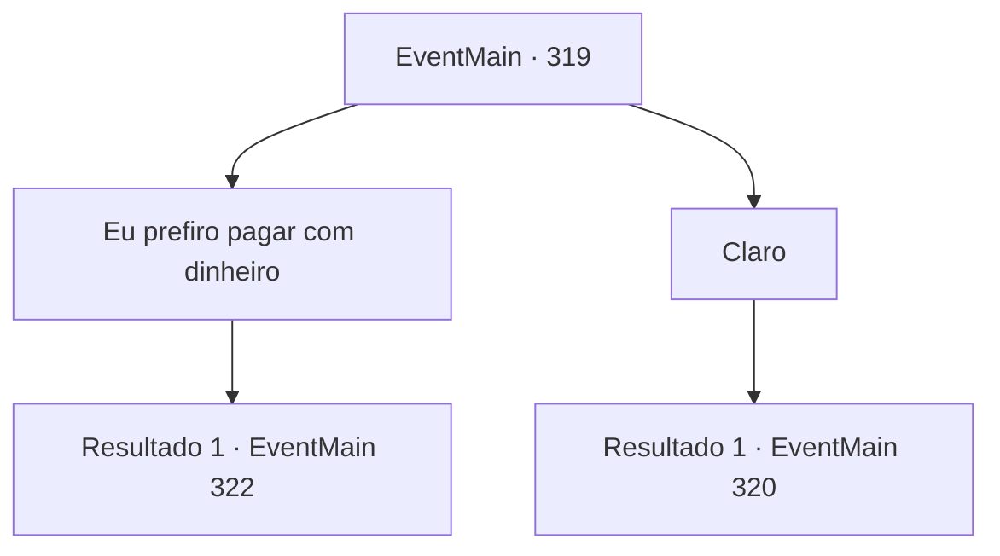

# Eventos principais · 319

[Índice da tabela](index.md) · [Índice geral](../index.md)

ID: `pt:EventMain:319` · Fonte: `EventMain4` · Versão: 1.2.47.

Mapeamento estático dos arquivos; a disponibilidade e a execução dependem do estado da run.

## Texto do evento

Você está procurando passagem para a Ilha Illaha em uma cidade costeira chamada 'Caça à Baleia'. Enquanto você procura um navio, um pescador local se aproxima de você. 

 "Procurando um navio?"

 Ele diz que se você puder encontrar e derrotar o monstro que continua mexendo com suas armadilhas para peixes, ele lhe dará uma carona.

## Dados de entrada

```json
{
  "id": 319,
  "grade": 1,
  "normalGoal": "",
  "required": "13_3_5|1_2_30"
}
```

## Mapa das escolhas



## Escolhas e resultados

### Escolha 1

Eu prefiro pagar com dinheiro

Requisitos e outros campos da escolha:

```json
{
  "required": ""
}
```

#### Resultado 1.1

Você diz a ele que vai pagar a viagem. Ele diz que se você lhe pagar 30 ouros, ele o levará para a Ilha Illaha com segurança.

Continuação registrada: [Evento 322](0322.md) na mesma tabela.

```json
{
  "required": "",
  "chance": "1",
  "nextEvent": 322,
  "type": 2,
  "reward": ""
}
```

### Escolha 2

Claro

Requisitos e outros campos da escolha:

```json
{
  "required": ""
}
```

#### Resultado 2.1

Você decide ajudar o pescador a pegar o monstro. Ele leva você para onde ele instalou as armadilhas para peixes. 

 "Aqui... bem aqui, coloquei minhas armadilhas para peixes. E como você pode ver, alguém, ou alguma coisa, os desfiou em pedaços. Vamos nos esconder e esperar por aqui. O culpado deve aparecer em breve."

 Ao terminar, o pescador joga fora as armadilhas destruídas e instala uma nova. Você e ele se escondem em um arbusto próximo. 

 Depois de algumas horas, quando o sol desaparece e a escuridão se instala, um grupo de pequenas sombras aparece perto da armadilha para peixes. Eles começam a falar palavras sem sentido e logo começam a quebrar a armadilha para peixes. Após uma inspeção cuidadosa, você percebe que essas criaturas são sahuagins. 

Continuação registrada: [Evento 320](0320.md) na mesma tabela.

```json
{
  "required": "",
  "chance": "1",
  "nextEvent": 320,
  "type": 2,
  "reward": ""
}
```

## Referências que chegam a este evento

Nenhum `nextEvent` positivo da mesma tabela aponta para este nó. Isso não prova que seja inacessível: sorteio e estado de história podem selecioná-lo.

