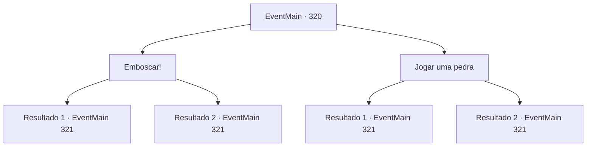

# Eventos principais · 320

[Índice da tabela](index.md) · [Índice geral](../index.md)

ID: `pt:EventMain:320` · Fonte: `EventMain4` · Versão: 1.2.47.

Mapeamento estático dos arquivos; a disponibilidade e a execução dependem do estado da run.

## Texto do evento

*Sem texto no arquivo.*

## Dados de entrada

```json
{
  "id": 320,
  "grade": 1,
  "normalGoal": "",
  "required": ""
}
```

## Mapa das escolhas



## Escolhas e resultados

### Escolha 1

Emboscar!

Requisitos e outros campos da escolha:

```json
{
  "required": ""
}
```

#### Resultado 1.1

Você se esgueira até os sahuagins e, em um instante, quebra o pescoço de um dos sahuagins. Quando os outros sahuagins ouvem o som de ossos se quebrando, eles percebem que um de seus companheiros caiu. Enfurecidos, eles apontam suas lanças para o seu rosto. 

Continuação registrada: [Evento 321](0321.md) na mesma tabela.

```json
{
  "required": "",
  "chance": "1|0_6_1",
  "nextEvent": 321,
  "type": 0,
  "reward": "6_2_13",
  "place": 8
}
```

#### Resultado 1.2

Você tenta se aproximar dos sahuagins com cuidado. Mas eles percebem sua presença e apontam suas lanças para seu rosto, enfurecidos.

Continuação registrada: [Evento 321](0321.md) na mesma tabela.

```json
{
  "required": "",
  "chance": "11",
  "nextEvent": 321,
  "type": 1,
  "reward": "6_3_13",
  "place": 8
}
```

### Escolha 2

Jogar uma pedra

Requisitos e outros campos da escolha:

```json
{
  "required": ""
}
```

#### Resultado 2.1

Você pega uma pedra do chão próximo e joga na cabeça de um dos sahuagin. Com um baque alto, o sahuagin cai após ser atingido pela pedra. Quando os outros sahuagins percebem que um de seus companheiros caiu, eles apontam suas lanças para o seu rosto, enfurecidos.

Continuação registrada: [Evento 321](0321.md) na mesma tabela.

```json
{
  "required": "",
  "chance": "1|0_5_1",
  "nextEvent": 321,
  "type": 0,
  "reward": "6_2_13",
  "place": 8
}
```

#### Resultado 2.2

Você pega uma pedra do chão próximo e joga na cabeça de um dos sahuagin. Mas parece que o arremesso não foi forte o suficiente para derrubar o sahuagin. Na verdade, isso só o enfureceu mais. Enfurecidos, os sahuagins começam a atacar você.

Continuação registrada: [Evento 321](0321.md) na mesma tabela.

```json
{
  "required": "",
  "chance": "10",
  "nextEvent": 321,
  "type": 1,
  "reward": "6_3_13",
  "place": 8
}
```

## Referências que chegam a este evento

- [Evento 319 · escolha 2 · resultado 1](0319.md#escolha-2)
- [Evento 322 · escolha 3 · resultado 1](0322.md#escolha-3)
