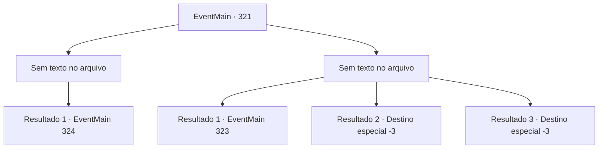

# Eventos principais · 321

[Índice da tabela](index.md) · [Índice geral](../index.md)

ID: `pt:EventMain:321` · Fonte: `EventMain4` · Versão: 1.2.47.

Mapeamento estático dos arquivos; a disponibilidade e a execução dependem do estado da run.

## Texto do evento

*Sem texto no arquivo.*

## Dados de entrada

```json
{
  "id": 321,
  "grade": 1,
  "normalGoal": "",
  "required": ""
}
```

## Mapa das escolhas



## Escolhas e resultados

### Escolha 1

*Sem texto no arquivo; o papel dessa opção depende da interface do jogo.*

Requisitos e outros campos da escolha:

```json
{
  "required": ""
}
```

#### Resultado 1.1


 "Obrigado...! Essas malditas criaturinhas! Que felicidade! Vamos."

 O pescador agradece enquanto cospe em um dos sahuagins mortos. Ele então leva você ao seu navio. Como prometeu, ele lhe dá as boas-vindas a bordo e começa a navegar em direção à Ilha Illaha. |drawing_illahaFortress| Illaha Island é uma ilha pequena, mas completamente fortificada. Você pode ver um grande número de soldados patrulhando a ilha. Conforme o navio se aproxima da ilha, uma das patrulhas se aproxima de você. 

 "Quem é você, e que negócios você tem nesta ilha? Se identifique."

  

Continuação registrada: [Evento 324](0324.md) na mesma tabela.

```json
{
  "required": "",
  "chance": "1",
  "nextEvent": 324,
  "type": 2,
  "reward": ""
}
```

### Escolha 2

*Sem texto no arquivo; o papel dessa opção depende da interface do jogo.*

Requisitos e outros campos da escolha:

```json
{
  "required": ""
}
```

#### Resultado 2.1

Incapaz de lutar contra os sahuagins, você foge com o pescador. Desapontado e arrependido de, em primeiro lugar, ter contratado seus serviços. Ele vai embora depois de resmungar. Você precisa encontrar outra maneira de chegar à ilha. 

Continuação registrada: [Evento 323](0323.md) na mesma tabela.

```json
{
  "required": "1_0_2|1_1_2",
  "chance": "1",
  "nextEvent": 323,
  "type": 2,
  "reward": "0_0_-1|0_1_-1|5_292_1"
}
```

#### Resultado 2.2

As lanças dos sahuagins abrem caminho pelo seu peito. O pescador foge gritando e você lentamente perde a consciência.

Continuação registrada: [Destino especial `-3`](../destinos-especiais.md).

```json
{
  "required": "2_0_2",
  "chance": "1",
  "nextEvent": -3,
  "type": 2,
  "reward": "0_0_-1|0_1_-1"
}
```

#### Resultado 2.3

As lanças dos sahuagins abrem caminho pelo seu peito. O pescador foge gritando e você lentamente perde a consciência.

Continuação registrada: [Destino especial `-3`](../destinos-especiais.md).

```json
{
  "required": "2_1_2",
  "chance": "1",
  "nextEvent": -3,
  "type": 2,
  "reward": "0_0_-1|0_1_-1"
}
```

## Referências que chegam a este evento

- [Evento 320 · escolha 1 · resultado 1](0320.md#escolha-1)
- [Evento 320 · escolha 1 · resultado 2](0320.md#escolha-1)
- [Evento 320 · escolha 2 · resultado 1](0320.md#escolha-2)
- [Evento 320 · escolha 2 · resultado 2](0320.md#escolha-2)
