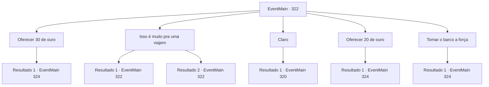

# Eventos principais · 322

[Índice da tabela](index.md) · [Índice geral](../index.md)

ID: `pt:EventMain:322` · Fonte: `EventMain4` · Versão: 1.2.47.

Mapeamento estático dos arquivos; a disponibilidade e a execução dependem do estado da run.

## Texto do evento

*Sem texto no arquivo.*

## Dados de entrada

```json
{
  "id": 322,
  "grade": 1,
  "normalGoal": "",
  "required": ""
}
```

## Mapa das escolhas



## Escolhas e resultados

### Escolha 1

Oferecer 30 de ouro

Requisitos e outros campos da escolha:

```json
{
  "required": "1_4_30|18_249_1"
}
```

#### Resultado 1.1

Você paga ao pescador a quantia prometida e embarca em seu navio. Como prometido, ele lhe dá as boas-vindas a bordo e começa a navegar em direção à Ilha Illaha. |drawing_illahaFortress| Illaha Island é uma ilha pequena, mas completamente fortificada. Você pode ver um grande número de soldados patrulhando a ilha. Conforme o navio se aproxima da ilha, uma das patrulhas se aproxima de você. 

 "Quem é você, e que negócios você tem nesta ilha? Se identifique."

 

Continuação registrada: [Evento 324](0324.md) na mesma tabela.

```json
{
  "required": "",
  "chance": "1",
  "nextEvent": 324,
  "type": 2,
  "reward": "0_4_-30"
}
```

### Escolha 2

Isso é muito pra uma viajem

Requisitos e outros campos da escolha:

```json
{
  "required": "5_249_0"
}
```

#### Resultado 2.1

Você pede a ele para baixar o preço. Ele hesita um pouco antes de acenar com a cabeça. 

 "Quer saber... Tudo bem. 20 de ouro é o suficiente."


Continuação registrada: [Evento 322](0322.md) na mesma tabela.

```json
{
  "required": "",
  "chance": "1|0_12_1",
  "nextEvent": 322,
  "type": 0,
  "reward": "5_249_1"
}
```

#### Resultado 2.2

Você pede a ele para baixar o preço. Ele hesita um pouco antes de balançar a cabeça. 

 "30 ouro. Esse é o mínimo que posso cobrar."


Continuação registrada: [Evento 322](0322.md) na mesma tabela.

```json
{
  "required": "",
  "chance": "1",
  "nextEvent": 322,
  "type": 1,
  "reward": "5_249_2"
}
```

### Escolha 3

Claro

Requisitos e outros campos da escolha:

```json
{
  "required": "18_292_1"
}
```

#### Resultado 3.1

Você decide ajudar o pescador a pegar o monstro. Ele leva você para onde ele instalou as armadilhas para peixes. 

 "Aqui... bem aqui, coloquei minhas armadilhas para peixes. E como você pode ver, alguém, ou alguma coisa, os desfiou em pedaços. Vamos nos esconder e esperar por aqui. O culpado deve aparecer em breve."

 Ao terminar, o pescador joga fora as armadilhas destruídas e instala uma nova. Você e ele se escondem em um arbusto próximo. 

 Depois de algumas horas, quando o sol desaparece e a escuridão se instala, um grupo de pequenas sombras aparece perto da armadilha para peixes. Eles começam a falar palavras sem sentido e logo começam a quebrar a armadilha para peixes. Após uma inspeção cuidadosa, você percebe que essas criaturas são sahuagins. 

Continuação registrada: [Evento 320](0320.md) na mesma tabela.

```json
{
  "required": "",
  "chance": "1",
  "nextEvent": 320,
  "type": 2,
  "reward": ""
}
```

### Escolha 4

Oferecer 20 de ouro

Requisitos e outros campos da escolha:

```json
{
  "required": "1_4_20|5_249_1"
}
```

#### Resultado 4.1

Você paga ao pescador a quantia prometida e embarca em seu navio. Como prometido, ele lhe dá as boas-vindas a bordo e começa a navegar em direção à Ilha Illaha. |drawing_illahaFortress| Illaha Island é uma ilha pequena, mas completamente fortificada. Você pode ver um grande número de soldados patrulhando a ilha. Conforme o navio se aproxima da ilha, uma das patrulhas se aproxima de você. 

 "Quem é você, e que negócios você tem nesta ilha? Se identifique."

 

Continuação registrada: [Evento 324](0324.md) na mesma tabela.

```json
{
  "required": "",
  "chance": "1",
  "nextEvent": 324,
  "type": 2,
  "reward": "0_4_-20"
}
```

### Escolha 5

Tomar o barco a força

Requisitos e outros campos da escolha:

```json
{
  "required": "18_292_1"
}
```

#### Resultado 5.1

Você bateu nele, pedindo sua 'cooperação'. Você exige que o pescador o leve para a ilha. Finalmente cedendo à sua ameaça, o pescador responde, soluçando. 

 "*tosse*... *tosse*... Chega...!! O porto.. Vamos para o porto.."

 O pescador leva você ao seu navio, 'O Pescador Urbano'. Sem outra escolha, ele leva você para a Ilha Illaha. |drawing_illahaFortress| A ilha Ilhaha é uma ilha pequena, mas completamente fortificada. Você pode ver um grande número de soldados patrulhando a ilha. Conforme o navio se aproxima da ilha, uma das patrulhas se aproxima de você. 

 "Quem é você, e que negócios você tem nesta ilha? Se identifique."


Continuação registrada: [Evento 324](0324.md) na mesma tabela.

```json
{
  "required": "",
  "chance": "1",
  "nextEvent": 324,
  "type": 2,
  "reward": "0_3_-4"
}
```

## Referências que chegam a este evento

- [Evento 319 · escolha 1 · resultado 1](0319.md#escolha-1)
- [Evento 322 · escolha 2 · resultado 1](0322.md#escolha-2)
- [Evento 322 · escolha 2 · resultado 2](0322.md#escolha-2)
- [Evento 323 · escolha 2 · resultado 1](0323.md#escolha-2)
