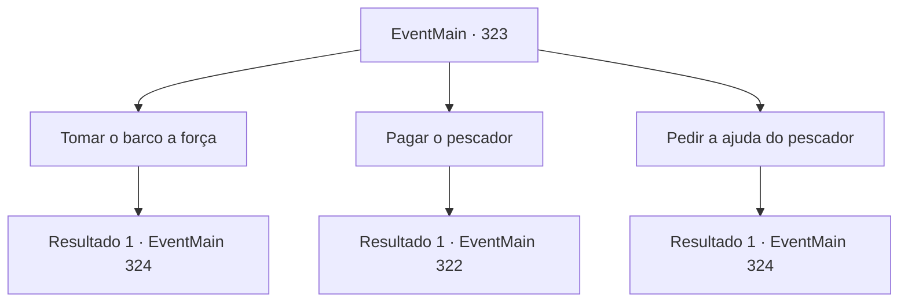

# Eventos principais · 323

[Índice da tabela](index.md) · [Índice geral](../index.md)

ID: `pt:EventMain:323` · Fonte: `EventMain4` · Versão: 1.2.47.

Mapeamento estático dos arquivos; a disponibilidade e a execução dependem do estado da run.

## Texto do evento

*Sem texto no arquivo.*

## Dados de entrada

```json
{
  "id": 323,
  "grade": 1,
  "normalGoal": "",
  "required": ""
}
```

## Mapa das escolhas



## Escolhas e resultados

### Escolha 1

Tomar o barco a força

Requisitos e outros campos da escolha:

```json
{
  "required": ""
}
```

#### Resultado 1.1

Quando o pescador vira as costas para você e começa a se afastar, você o agarra pelas costas. Você então o espanca, pedindo sua 'cooperação'. Você exige que o pescador o leve para a ilha. Finalmente cedendo à sua ameaça, o pescador responde, soluçando. 

 "*tosse*... *tosse*... Chega...!! O porto.. Vamos para o porto.."

 O pescador leva você ao seu navio, 'O Pescador Urbano'. Sem outra escolha, ele leva você para a Ilha Illaha. |drawing_illahaFortress| A ilha Ilhaha é uma ilha pequena, mas completamente fortificada. Você pode ver um grande número de soldados patrulhando a ilha. Conforme o navio se aproxima da ilha, uma das patrulhas se aproxima de você. 

 "Quem é você, e que negócios você tem nesta ilha? Se identifique."


Continuação registrada: [Evento 324](0324.md) na mesma tabela.

```json
{
  "required": "",
  "chance": "1",
  "nextEvent": 324,
  "type": 2,
  "reward": "0_3_-4"
}
```

### Escolha 2

Pagar o pescador

Requisitos e outros campos da escolha:

```json
{
  "required": ""
}
```

#### Resultado 2.1

Você para o pescador enquanto ele está indo embora. Você promete a ele que pagará o ouro, pedindo uma carona para a Ilha Illaha. Ele diz que se você pagar 30 de ouro, ele vai te levar para a ilha.

Continuação registrada: [Evento 322](0322.md) na mesma tabela.

```json
{
  "required": "",
  "chance": "1",
  "nextEvent": 322,
  "type": 2,
  "reward": ""
}
```

### Escolha 3

Pedir a ajuda do pescador

Requisitos e outros campos da escolha:

```json
{
  "required": "1_3_15"
}
```

#### Resultado 3.1

Você para o pescador enquanto ele está indo embora. Você faz o possível para parecer desesperado, implorando por ajuda. Ele olha profundamente em seus olhos por um tempo antes de finalmente assentir. 

 "Hmph... Tudo bem. Você parece desesperado tudo bem. Eu vou te ajudar."

 O pescador leva você ao seu navio, 'O Pescador Urbano'. Ele diz para você embarcar e, em seguida, navega para a Ilha Illaha. |drawing_illahaFortress| Illaha Island é uma ilha pequena, mas completamente fortificada. Você pode ver um grande número de soldados patrulhando a ilha. Conforme o navio se aproxima da ilha, uma das patrulhas se aproxima de você. 

 "Quem é você, e que negócios você tem nesta ilha? Se identifique."


Continuação registrada: [Evento 324](0324.md) na mesma tabela.

```json
{
  "required": "",
  "chance": "1",
  "nextEvent": 324,
  "type": 2,
  "reward": ""
}
```

## Referências que chegam a este evento

- [Evento 321 · escolha 2 · resultado 1](0321.md#escolha-2)
