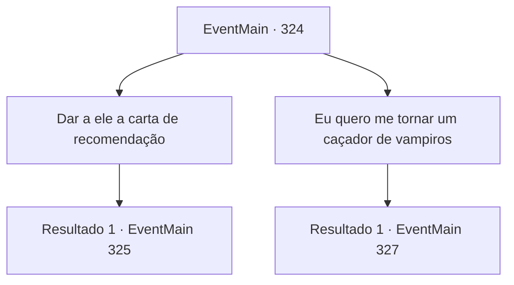

# Eventos principais · 324

[Índice da tabela](index.md) · [Índice geral](../index.md)

ID: `pt:EventMain:324` · Fonte: `EventMain4` · Versão: 1.2.47.

Mapeamento estático dos arquivos; a disponibilidade e a execução dependem do estado da run.

## Texto do evento

*Sem texto no arquivo.*

## Dados de entrada

```json
{
  "id": 324,
  "grade": 1,
  "normalGoal": "",
  "required": ""
}
```

## Mapa das escolhas



## Escolhas e resultados

### Escolha 1

Dar a ele a carta de recomendação

Requisitos e outros campos da escolha:

```json
{
  "required": "8_226_1"
}
```

#### Resultado 1.1

Depois de receber sua carta de recomendação, o soldado sinaliza para você segui-lo. Você o segue até o portão da frente da fortaleza. O portão é adornado com uma bandeira azul que tem a imagem de uma galinha. Parece que é isso que simboliza os 'Mercenários Ziwa'. O soldado que o conduziu bate na porta. Com um som assustador, a enorme porta se abre. Atravessa as paredes exteriores, cobertas por camadas de grossas barricadas de pedra, chegando ao salão principal, onde a única decoração que se pode encontrar são as trepadeiras que crescem nas paredes. Um crucifixo gigante é a primeira coisa que chama sua atenção. A freira que está na frente dele se aproxima de você. |drawing_maria| 

 "Olá, criança. Eu sou 'Maria', a líder dos Mercenários Ziwa."

 Ela definitivamente não é a típica 'freira'. Colocado em sua boca está um cigarro, e seu hábito está prestes a se abrir, mal segurando seus músculos. Suas mãos, expostas sob as mangas, estão cheias de cicatrizes e calos.

Continuação registrada: [Evento 325](0325.md) na mesma tabela.

```json
{
  "required": "",
  "chance": "1",
  "nextEvent": 325,
  "type": 2,
  "reward": "4_226_1"
}
```

### Escolha 2

Eu quero me tornar um caçador de vampiros

Requisitos e outros campos da escolha:

```json
{
  "required": "10_226_1"
}
```

#### Resultado 2.1

Depois de receber sua carta de recomendação, o soldado sinaliza para você segui-lo. Você o segue até o portão da frente da fortaleza. O portão é adornado com uma bandeira azul que tem a imagem de uma galinha. Parece que é isso que simboliza os 'Mercenários Ziwa'. O soldado que o conduziu bate na porta. Com um som assustador, a enorme porta se abre. Você se move pelas paredes externas, cobertas por camadas de grossas barricadas de pedra, chegando a outro prédio. Você é levado pelas escadas para o porão. No porão é uma área de treinamento enorme. Você vê uma freira parada ali. |drawing_maria| 

 "Olá, criança. Eu sou 'Maria', a líder dos Mercenários Ziwa."

 Ela definitivamente não é a típica 'freira'. Colocado em sua boca está um cigarro, e seu hábito está prestes a se abrir, mal segurando seus músculos. Suas mãos, expostas sob as mangas, estão cheias de cicatrizes e calos. 

 "Para alguém se tornar parte da nossa banda, eles devem provar que são dignos. Não deixamos qualquer um trabalhar em nosso nome."

 Ao lado dela está um homem de tez pálida. 

Continuação registrada: [Evento 327](0327.md) na mesma tabela.

```json
{
  "required": "",
  "chance": "1",
  "nextEvent": 327,
  "type": 2,
  "reward": ""
}
```

## Referências que chegam a este evento

- [Evento 321 · escolha 1 · resultado 1](0321.md#escolha-1)
- [Evento 322 · escolha 1 · resultado 1](0322.md#escolha-1)
- [Evento 322 · escolha 4 · resultado 1](0322.md#escolha-4)
- [Evento 322 · escolha 5 · resultado 1](0322.md#escolha-5)
- [Evento 323 · escolha 1 · resultado 1](0323.md#escolha-1)
- [Evento 323 · escolha 3 · resultado 1](0323.md#escolha-3)
