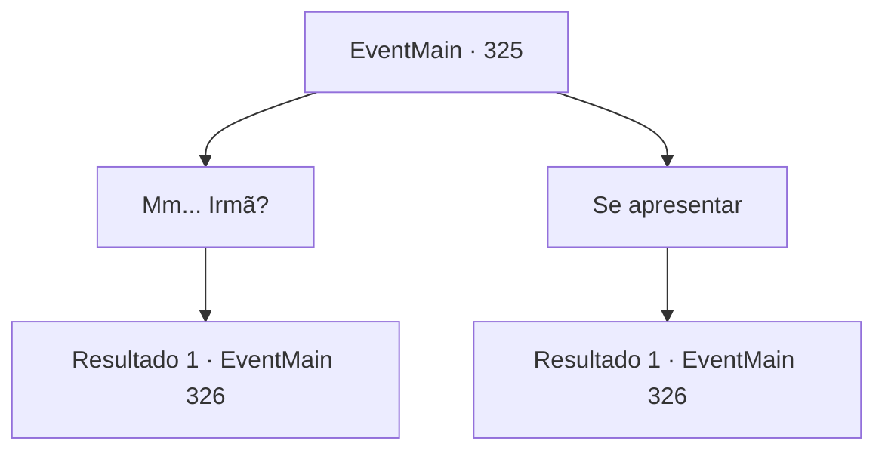

# Eventos principais · 325

[Índice da tabela](index.md) · [Índice geral](../index.md)

ID: `pt:EventMain:325` · Fonte: `EventMain4` · Versão: 1.2.47.

Mapeamento estático dos arquivos; a disponibilidade e a execução dependem do estado da run.

## Texto do evento

*Sem texto no arquivo.*

## Dados de entrada

```json
{
  "id": 325,
  "grade": 1,
  "normalGoal": "",
  "required": ""
}
```

## Mapa das escolhas



## Escolhas e resultados

### Escolha 1

Mm... Irmã?

Requisitos e outros campos da escolha:

```json
{
  "required": ""
}
```

#### Resultado 1.1

Ela sorri depois de ver seu rosto. 

 "Eu sei eu sei. Posso ser um pouco 'diferente' das outras Irmãs. Mas ainda assim, você deve ter vindo até aqui para se tornar um mercenário, certo?"

 A freira sugere que você comece a treinar imediatamente. Assim que ela terminar, um mercenário veterano se aproxima de você e lhe entrega os equipamentos Ziwa Mercenaries. 

 "Siga-me, calouro. Eu vou fazer de você um caçador de vampiros."


Continuação registrada: [Evento 326](0326.md) na mesma tabela.

```json
{
  "required": "",
  "chance": "1",
  "nextEvent": 326,
  "type": 2,
  "reward": "3_230_1"
}
```

### Escolha 2

Se apresentar

Requisitos e outros campos da escolha:

```json
{
  "required": ""
}
```

#### Resultado 2.1

Você pega as mãos da freira e se apresenta educadamente. Ela sugere que você comece a treinar imediatamente, sem mais delongas. Assim que ela terminar, um mercenário veterano se aproxima de você e lhe entrega os equipamentos Ziwa Mercenaries. 

 "Siga-me, calouro. Eu vou fazer de você um caçador de vampiros."


Continuação registrada: [Evento 326](0326.md) na mesma tabela.

```json
{
  "required": "",
  "chance": "1",
  "nextEvent": 326,
  "type": 2,
  "reward": "3_230_1"
}
```

## Referências que chegam a este evento

- [Evento 324 · escolha 1 · resultado 1](0324.md#escolha-1)
