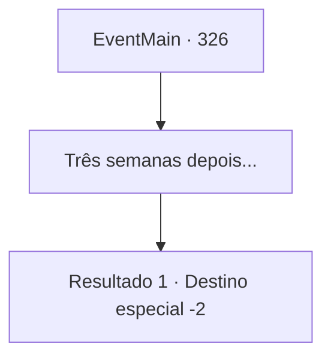

# Eventos principais · 326

[Índice da tabela](index.md) · [Índice geral](../index.md)

ID: `pt:EventMain:326` · Fonte: `EventMain4` · Versão: 1.2.47.

Mapeamento estático dos arquivos; a disponibilidade e a execução dependem do estado da run.

## Texto do evento

*Sem texto no arquivo.*

## Dados de entrada

```json
{
  "id": 326,
  "grade": 1,
  "normalGoal": "",
  "required": ""
}
```

## Mapa das escolhas



## Escolhas e resultados

### Escolha 1

Três semanas depois...

Requisitos e outros campos da escolha:

```json
{
  "required": ""
}
```

#### Resultado 1.1

Você passa por um regime de treinamento duro, às vezes até perto da morte, aprendendo tudo sobre vampiros - curiosidades gerais, como lutar contra um e alguns movimentos de combate úteis que são eficazes contra eles. Você absorveu tudo o que os mercenários tinham a oferecer. Um dia, Maria, a líder dos Mercenários Ziwa, convoca você e alguns companheiros caçadores para o salão principal. Ela vai direto ao ponto. 

 "Romb. A cidade dos jogos e da diversão mundana, onde todos os tipos de almas corrompidas se juntam como mariposas para a chama. Houve um relato de um homem suspeito de ser um vampiro no Coliseu de lá. Faça uma pesquisa completa e certifique-se de relatar qualquer coisa suspeita."

 Maria também preenche os outros caçadores com tarefas diferentes. Ela também lhe dá uma pequena quantidade de ouro, como pagamento adiantado pela pesquisa. Você pega o ouro e volta para o continente.

Continuação registrada: [Destino especial `-2`](../destinos-especiais.md).

```json
{
  "required": "",
  "chance": "1",
  "nextEvent": -2,
  "type": 2,
  "reward": "0_4_100|13_3_7|0_5_1|0_6_2|0_2_1"
}
```

## Referências que chegam a este evento

- [Evento 325 · escolha 1 · resultado 1](0325.md#escolha-1)
- [Evento 325 · escolha 2 · resultado 1](0325.md#escolha-2)
- [Evento 328 · escolha 1 · resultado 1](0328.md#escolha-1)
