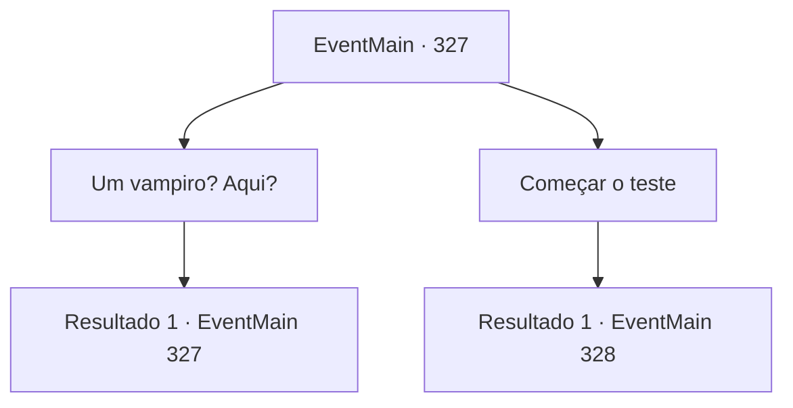

# Eventos principais · 327

[Índice da tabela](index.md) · [Índice geral](../index.md)

ID: `pt:EventMain:327` · Fonte: `EventMain4` · Versão: 1.2.47.

Mapeamento estático dos arquivos; a disponibilidade e a execução dependem do estado da run.

## Texto do evento

*Sem texto no arquivo.*

## Dados de entrada

```json
{
  "id": 327,
  "grade": 1,
  "normalGoal": "",
  "required": ""
}
```

## Mapa das escolhas



## Escolhas e resultados

### Escolha 1

Um vampiro? Aqui?

Requisitos e outros campos da escolha:

```json
{
  "required": "5_250_0|1_14_14"
}
```

#### Resultado 1.1

Você percebe que o homem é um vampiro imediatamente. Você pergunta por que há um vampiro, dentro da sede dos caçadores de vampiros. A freira responde depois de expelir fumaça de seu cigarro. 

 "Bem... Ele é chamado de 'Tallua'. Um de nossos homens. Ele foi mordido por um vampiro durante uma caçada. Então ele se tornou um vampiro... mas, com pura força de vontade, ele se libertou da dominação do vampiro e voltou para cá. Agora ele ensina nossos irmãos como lutar contra vampiros. Mais alguma dúvida?"

 

Continuação registrada: [Evento 327](0327.md) na mesma tabela.

```json
{
  "required": "",
  "chance": "1",
  "nextEvent": 327,
  "type": 2,
  "reward": "5_250_1"
}
```

### Escolha 2

Começar o teste

Requisitos e outros campos da escolha:

```json
{
  "required": ""
}
```

#### Resultado 2.1

Você diz que está pronto para o julgamento. A freira assente e responde. 

 "Irmão Tallua. Não pegue leve com ele."

 O homem chamado Tallua acena com a cabeça e ataca você.

Continuação registrada: [Evento 328](0328.md) na mesma tabela.

```json
{
  "required": "",
  "chance": "1",
  "nextEvent": 328,
  "type": 2,
  "reward": "6_0_124",
  "place": 7
}
```

## Referências que chegam a este evento

- [Evento 324 · escolha 2 · resultado 1](0324.md#escolha-2)
- [Evento 327 · escolha 1 · resultado 1](0327.md#escolha-1)
