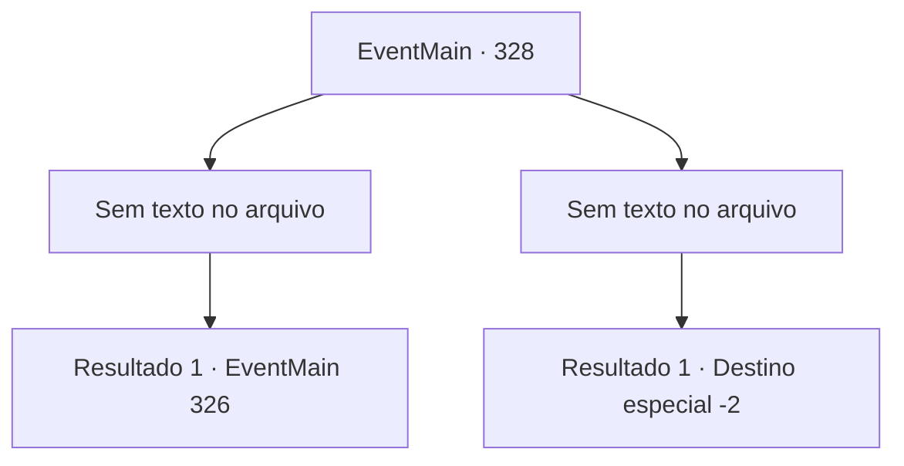

# Eventos principais · 328

[Índice da tabela](index.md) · [Índice geral](../index.md)

ID: `pt:EventMain:328` · Fonte: `EventMain4` · Versão: 1.2.47.

Mapeamento estático dos arquivos; a disponibilidade e a execução dependem do estado da run.

## Texto do evento

*Sem texto no arquivo.*

## Dados de entrada

```json
{
  "id": 328,
  "grade": 1,
  "normalGoal": "",
  "required": ""
}
```

## Mapa das escolhas



## Escolhas e resultados

### Escolha 1

*Sem texto no arquivo; o papel dessa opção depende da interface do jogo.*

Requisitos e outros campos da escolha:

```json
{
  "required": ""
}
```

#### Resultado 1.1

Você derrota Tallua. A freira levanta as sobrancelhas, exclamando com admiração. 

 "Hm... Obrigado, Tallua. Você realmente o derrotou de forma justa. Você luta bem, meu filho. Não há necessidade de formalidades. Você é, a partir de agora, um membro dos Mercenários Ziwa."

 Desta vez, a freira parece mais respeitosa do que antes. Ela sugere que você comece a treinar imediatamente. Assim que ela terminar, um mercenário veterano se aproxima de você e lhe entrega os equipamentos Ziwa Mercenaries. 

 "Siga-me, calouro. Eu vou fazer de você um caçador de vampiros."


Continuação registrada: [Evento 326](0326.md) na mesma tabela.

```json
{
  "required": "",
  "chance": "1",
  "nextEvent": 326,
  "type": 2,
  "reward": "3_230_1"
}
```

### Escolha 2

*Sem texto no arquivo; o papel dessa opção depende da interface do jogo.*

Requisitos e outros campos da escolha:

```json
{
  "required": ""
}
```

#### Resultado 2.1

Tallua usa suas pernas para fazer você tropeçar nelas. Logo, sua lâmina pousa próxima a sua garganta.  

 "Obrigado, Tallua."

  Tallua se afasta de você, embainhando sua lâmina.  A freira vem checar você.  

 "Acho que você vai precisar de algum dinheiro para encontrar um navio. Saia."

  Você é expulso da fortaleza.

Continuação registrada: [Destino especial `-2`](../destinos-especiais.md).

```json
{
  "required": "",
  "chance": "1",
  "nextEvent": -2,
  "type": 2,
  "reward": "13_3_11|0_4_30"
}
```

## Referências que chegam a este evento

- [Evento 327 · escolha 2 · resultado 1](0327.md#escolha-2)
