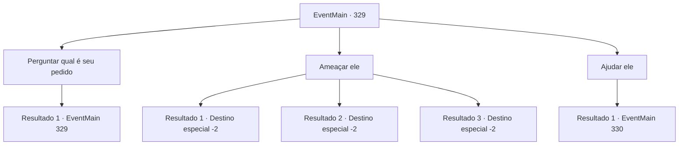

# Eventos principais · 329

[Índice da tabela](index.md) · [Índice geral](../index.md)

ID: `pt:EventMain:329` · Fonte: `EventMain4` · Versão: 1.2.47.

Mapeamento estático dos arquivos; a disponibilidade e a execução dependem do estado da run.

## Texto do evento

Você está se movendo por cidades e vilas para encontrar informações relacionadas aos 'Mercenários Ziwa'. Então, enquanto você está visitando o mercado, um padre se aproxima de você. 

 "Olá, aventureiro. Ouvi dizer que você está procurando pelos Mercenários Ziwa."

 Você concorda. Ele diz que se você tiver a gentileza de atender o pedido dele, ele lhe dirá a localização da sede deles.

## Dados de entrada

```json
{
  "id": 329,
  "grade": 1,
  "normalGoal": "",
  "required": "13_3_6|1_2_35"
}
```

## Mapa das escolhas



## Escolhas e resultados

### Escolha 1

Perguntar qual é seu pedido

Requisitos e outros campos da escolha:

```json
{
  "required": "5_251_0"
}
```

#### Resultado 1.1

O padre explica, apontando com os dedos um mosteiro localizado no pico de uma montanha próxima. 

 "Veja o mosteiro lá? Enquanto eu estava andando até o mercado para comprar comida, quase fui morto por um enorme javali. A besta servirá como uma ameaça para todos que vierem ao mosteiro. Por favor, derrote a criatura."


Continuação registrada: [Evento 329](0329.md) na mesma tabela.

```json
{
  "required": "",
  "chance": "1",
  "nextEvent": 329,
  "type": 2,
  "reward": "5_251_1"
}
```

### Escolha 2

Ameaçar ele

Requisitos e outros campos da escolha:

```json
{
  "required": "2_3_0"
}
```

#### Resultado 2.1

Você decide pedir a cooperação do padre em uma abordagem alternativa. Você pega o padre pelos colarinhos e puxa para perto do seu rosto, exigindo que ele lhe conte tudo o que sabe. É super efetivo! 

 "*tosse*...*tosse*... Il.. Ilha de Illaha. Vá... Para lá."

 Você solta o padre e vai embora para encontrar um navio que o levará até lá.

Continuação registrada: [Destino especial `-2`](../destinos-especiais.md).

```json
{
  "required": "",
  "chance": "1|0_12_1",
  "nextEvent": -2,
  "type": 0,
  "reward": "0_3_-1|13_3_5|0_2_1"
}
```

#### Resultado 2.2

Você decide pedir a cooperação do padre em uma abordagem alternativa. Você pega o padre pelos colarinhos e puxa para perto do seu rosto, exigindo que ele lhe conte tudo o que sabe. É super efetivo! 

 "*tosse*...*tosse*... Il.. Ilha de Illaha. Vá... Para lá."

 Você solta o padre e vai embora para encontrar um navio que o levará até lá.

Continuação registrada: [Destino especial `-2`](../destinos-especiais.md).

```json
{
  "required": "20_1_2",
  "chance": "1|0_12_1",
  "nextEvent": -2,
  "type": 0,
  "reward": "0_3_-1|13_3_5|0_2_1"
}
```

#### Resultado 2.3

Você decide pedir a cooperação do padre em uma abordagem alternativa. Você pega o padre pelos colarinhos e puxa para perto do seu rosto, exigindo que ele lhe conte tudo o que sabe. Não é muito eficaz...  

 "Deixe... Solte!!"

  Ele se liberta de suas garras e organiza seu manto.  Ele então vai embora reclamando.

Continuação registrada: [Destino especial `-2`](../destinos-especiais.md).

```json
{
  "required": "",
  "chance": "20",
  "nextEvent": -2,
  "type": 1,
  "reward": "0_3_-1|13_3_11"
}
```

### Escolha 3

Ajudar ele

Requisitos e outros campos da escolha:

```json
{
  "required": "5_251_1"
}
```

#### Resultado 3.1

O rosto do padre se ilumina ao ouvir sua resposta. Ele o conduz ao mosteiro. Você e o padre vasculham o caminho para o mosteiro, verificando cada arbusto e trilha. Depois de procurar por um longo tempo, você encontra o que parece ser pegadas de javali. O padre vê as pegadas e acena com a cabeça. 

 "Um animal capaz de deixar pegadas desse tamanho? Este é o que me atacou, sem dúvida."

 Assim que ele termina, uma respiração áspera pode ser ouvida. Você vira a cabeça para onde o som veio. Você faz contato visual com um enorme javali. Você não tem certeza do porquê, mas ele avança furiosamente contra você.

Continuação registrada: [Evento 330](0330.md) na mesma tabela.

```json
{
  "required": "",
  "chance": "1",
  "nextEvent": 330,
  "type": 2,
  "reward": "6_0_46",
  "place": 1
}
```

## Referências que chegam a este evento

- [Evento 329 · escolha 1 · resultado 1](0329.md#escolha-1)
