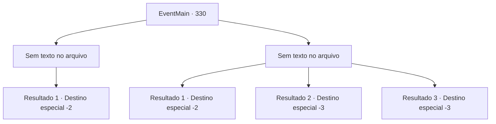

# Eventos principais · 330

[Índice da tabela](index.md) · [Índice geral](../index.md)

ID: `pt:EventMain:330` · Fonte: `EventMain4` · Versão: 1.2.47.

Mapeamento estático dos arquivos; a disponibilidade e a execução dependem do estado da run.

## Texto do evento

*Sem texto no arquivo.*

## Dados de entrada

```json
{
  "id": 330,
  "grade": 1,
  "normalGoal": "",
  "required": ""
}
```

## Mapa das escolhas



## Escolhas e resultados

### Escolha 1

*Sem texto no arquivo; o papel dessa opção depende da interface do jogo.*

Requisitos e outros campos da escolha:

```json
{
  "required": ""
}
```

#### Resultado 1.1

Você lida com o javali de forma magistral. Depois de testemunhar suas proezas de combate, o padre dá um sorriso, satisfeito. 

 "Foi bom eu pedir sua ajuda, aventureiro. Obrigada. A sede dos Mercenários de Ziwa está localizada em 'Illaha Island'."

 Segundo ele, a Ilha de Illaha é uma ilha pequena, mas completamente fortificada. Ele também acrescenta que a forte segurança do local pode dificultar a entrada. O padre se despede e você se afasta para encontrar um navio que pode levá-lo à ilha.

Continuação registrada: [Destino especial `-2`](../destinos-especiais.md).

```json
{
  "required": "",
  "chance": "1",
  "nextEvent": -2,
  "type": 2,
  "reward": "0_3_2|13_3_5|0_2_1"
}
```

### Escolha 2

*Sem texto no arquivo; o papel dessa opção depende da interface do jogo.*

Requisitos e outros campos da escolha:

```json
{
  "required": ""
}
```

#### Resultado 2.1

Você corre de volta para o mercado junto com o padre. Ao perceber sinais de civilização o javali desiste da perseguição. Ele desaparece de volta na floresta atrás da estrada. 

 "*Uff*... *Uf*... Acho que não há outra opção. Eu deveria encontrar outro candidato adequado... Mas, acho que sua tentativa foi genuína e de bom coração... então vou lhe dizer. A sede dos Mercenários de Ziwa está localizada na Ilha Illaha."

 Segundo ele, a Ilha de Illaha é uma ilha pequena, mas completamente fortificada. Ele também acrescenta que a forte segurança do local pode dificultar a entrada. O padre se despede e você se afasta para encontrar um navio que pode levá-lo à ilha.

Continuação registrada: [Destino especial `-2`](../destinos-especiais.md).

```json
{
  "required": "1_0_2|1_1_2",
  "chance": "1",
  "nextEvent": -2,
  "type": 2,
  "reward": "0_3_2|13_3_5|0_0_-1|0_1_-1|0_2_1"
}
```

#### Resultado 2.2

As presas afiadas do javali cortam seu abdômen. Sentindo o cheiro de sangue, o javali se enfurece ainda mais, dando cabeçadas aqui e ali com você ainda preso em suas presas. Sentindo o sangue ferroso escorregar pela sua boca, você perde a consciência.

Continuação registrada: [Destino especial `-3`](../destinos-especiais.md).

```json
{
  "required": "2_0_2",
  "chance": "1",
  "nextEvent": -3,
  "type": 2,
  "reward": "0_0_-1|0_1_-1"
}
```

#### Resultado 2.3

As presas afiadas do javali cortam seu abdômen. Sentindo o cheiro de sangue, o javali se enfurece ainda mais, dando cabeçadas aqui e ali com você ainda preso em suas presas. Sentindo o sangue ferroso escorregar pela sua boca, você perde a consciência.

Continuação registrada: [Destino especial `-3`](../destinos-especiais.md).

```json
{
  "required": "2_1_2",
  "chance": "1",
  "nextEvent": -3,
  "type": 2,
  "reward": "0_0_-1|0_1_-1"
}
```

## Referências que chegam a este evento

- [Evento 329 · escolha 3 · resultado 1](0329.md#escolha-3)
