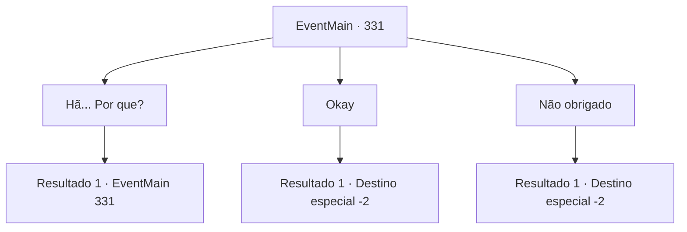

# Eventos principais · 331

[Índice da tabela](index.md) · [Índice geral](../index.md)

ID: `pt:EventMain:331` · Fonte: `EventMain4` · Versão: 1.2.47.

Mapeamento estático dos arquivos; a disponibilidade e a execução dependem do estado da run.

## Texto do evento

Você está se movendo por cidades e vilas para encontrar informações relacionadas a 'Ziwa Mercenaries'. Então, enquanto você está visitando o mercado, um padre se aproxima de você. 

 "Olá irmão. Ouvi dizer que você está procurando por mercenários Ziwa."

 Você acena. Ele sorri e continua. 

 "A sede dos Mercenários de Ziwa está localizada na 'Ilha de Illaha'. Segundo eles, eles construíram lá porque os vampiros não podem atravessar a água corrente. Se você não se importar, irmão... eu gostaria de lhe escrever uma carta de recomendação."


## Dados de entrada

```json
{
  "id": 331,
  "grade": 1,
  "normalGoal": "",
  "required": "13_3_6|1_2_35|1_3_15|20_3_1"
}
```

## Mapa das escolhas



## Escolhas e resultados

### Escolha 1

Hã... Por que?

Requisitos e outros campos da escolha:

```json
{
  "required": "5_286_0"
}
```

#### Resultado 1.1

O padre percebe sua suspeita. Ele aperta as mãos, falando. 

 "Ah... eu... não queria te assustar nem nada! Eu só desejo fornecer ajuda para alguém que está trilhando um caminho justo. Eu não vou te parar se você se sentir desconfortável e quiser ir embora."


Continuação registrada: [Evento 331](0331.md) na mesma tabela.

```json
{
  "required": "",
  "chance": "1",
  "nextEvent": 331,
  "type": 2,
  "reward": "5_286_1"
}
```

### Escolha 2

Okay

Requisitos e outros campos da escolha:

```json
{
  "required": ""
}
```

#### Resultado 2.1

Você não vê motivo para recusar a gentileza do estranho. Ele tira um pedaço de pergaminho e uma caneta de tinta dos bolsos, escrevendo uma carta de recomendação. 

 "Aqui está. Leve isso para a Ilha Illaha e entregue ao líder dos mercenários. Deixe que as bênçãos dos divinos estejam com você."

 Ele também lhe dá uma pequena quantidade de ouro, para ajudá-lo em suas viagens. Você se despede do padre e vai embora para encontrar um navio que pode levá-lo à ilha.  

Continuação registrada: [Destino especial `-2`](../destinos-especiais.md).

```json
{
  "required": "",
  "chance": "1",
  "nextEvent": -2,
  "type": 2,
  "reward": "0_4_30|13_3_5|3_226_1|0_2_1"
}
```

### Escolha 3

Não obrigado

Requisitos e outros campos da escolha:

```json
{
  "required": ""
}
```

#### Resultado 3.1

Você se recusa. O padre dá um passo para trás e se curva. 

 "Eu não quis desagradá-lo. Deixe que as bênçãos dos divinos estejam com você."

 Depois de se despedir, o padre se afasta. Você se despede do padre e vai embora para encontrar um navio que pode levá-lo à ilha.

Continuação registrada: [Destino especial `-2`](../destinos-especiais.md).

```json
{
  "required": "",
  "chance": "1",
  "nextEvent": -2,
  "type": 2,
  "reward": "0_3_3|13_3_5|0_2_1"
}
```

## Referências que chegam a este evento

- [Evento 331 · escolha 1 · resultado 1](0331.md#escolha-1)
