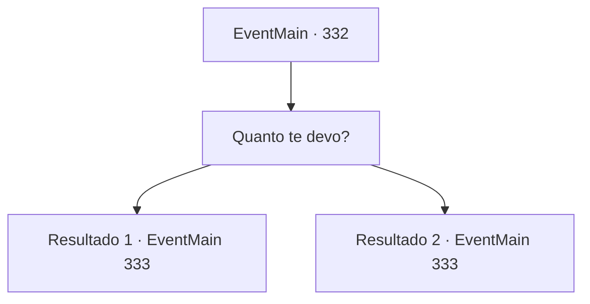

# Eventos principais · 332

[Índice da tabela](index.md) · [Índice geral](../index.md)

ID: `pt:EventMain:332` · Fonte: `EventMain4` · Versão: 1.2.47.

Mapeamento estático dos arquivos; a disponibilidade e a execução dependem do estado da run.

## Texto do evento

Você visita uma cidade chamada 'Rang Rud', para descansar seu corpo cansado. Mas antes que você possa encontrar um lugar para descansar, dois cobradores de dívidas de Anton se aproximam de você. 

 "Estivemos procurando por você em todos os lugares, {1}. Então, você está economizando algum ouro?"

 "Se você pega dinheiro, você tem que pagá!"

 Eles sorriem avidamente, expondo seus dentes sujos.

## Dados de entrada

```json
{
  "id": 332,
  "grade": 1,
  "normalGoal": "",
  "required": "13_3_7|1_2_50"
}
```

## Mapa das escolhas



## Escolhas e resultados

### Escolha 1

Quanto te devo?

Requisitos e outros campos da escolha:

```json
{
  "required": ""
}
```

#### Resultado 1.1

Um deles responde, revirando os olhos. 

 "Vamos ver... Seu valor original era 1500 ouro. Agora, com os juros... e sua irmãzinha... Serão 4400 de ouro no total."

 Ele acrescenta que sua irmã mais nova desempenhou um papel importante no pedido de redução do valor total da dívida.

Continuação registrada: [Evento 333](0333.md) na mesma tabela.

```json
{
  "required": "5_244_1",
  "chance": "1",
  "nextEvent": 333,
  "type": 2,
  "reward": ""
}
```

#### Resultado 1.2

Um deles responde, revirando os olhos. 

 "Vamos ver... Seu valor original era 1500 ouro. Agora, com os juros... e sua irmãzinha... Serão 4000 de ouro no total."

 Ele acrescenta que sua irmã mais nova desempenhou um papel importante no pedido de redução do valor total da dívida.

Continuação registrada: [Evento 333](0333.md) na mesma tabela.

```json
{
  "required": "18_244_1",
  "chance": "1",
  "nextEvent": 333,
  "type": 2,
  "reward": ""
}
```

## Referências que chegam a este evento

Nenhum `nextEvent` positivo da mesma tabela aponta para este nó. Isso não prova que seja inacessível: sorteio e estado de história podem selecioná-lo.

