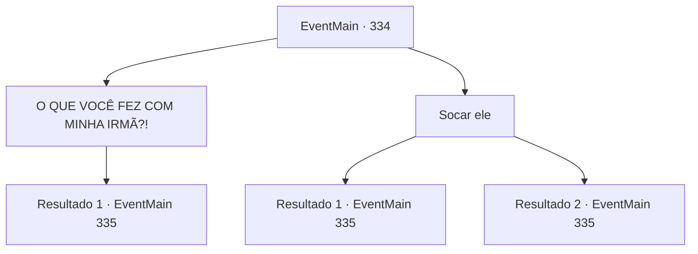

# Eventos principais · 334

[Índice da tabela](index.md) · [Índice geral](../index.md)

ID: `pt:EventMain:334` · Fonte: `EventMain4` · Versão: 1.2.47.

Mapeamento estático dos arquivos; a disponibilidade e a execução dependem do estado da run.

## Texto do evento

*Sem texto no arquivo.*

## Dados de entrada

```json
{
  "id": 334,
  "grade": 1,
  "normalGoal": "",
  "required": ""
}
```

## Mapa das escolhas



## Escolhas e resultados

### Escolha 1

O QUE VOCÊ FEZ COM MINHA IRMÃ?!

Requisitos e outros campos da escolha:

```json
{
  "required": ""
}
```

#### Resultado 1.1

Eles riem ainda mais, como se sua raiva fosse um entretenimento para eles. 

 "Kiyahaha! Calma, calma. Seu rosto está todo vermelho!"

 O esbelto cobrador de dívidas passa por você e envolve seus braços em volta do seu pescoço. Ele então continua com uma voz manchada de catarro. 

 "Rom. A cidade da devassidão. Sua irmã está trabalhando incansavelmente lá, levando felicidade e alegria para as pessoas. Em um lugar onde quanto mais sangue é derramado, a multidão enlouquece. Eu diria que trabalhar lá é muito mais interessante do que viajar pelo mundo cobrando dívidas como nós."

 Ele gesticula exageradamente para o céu com os braços e depois se curva, assim como um artista de circo se curvando para o público. Então ele fala com você. 

 "Eu não estou dizendo que você deve pagar o valor total agora. Anton pode ser muito 'generoso'. 400 de ouro por enquanto seria suficiente."


Continuação registrada: [Evento 335](0335.md) na mesma tabela.

```json
{
  "required": "",
  "chance": "1",
  "nextEvent": 335,
  "type": 2,
  "reward": ""
}
```

### Escolha 2

Socar ele

Requisitos e outros campos da escolha:

```json
{
  "required": ""
}
```

#### Resultado 2.1

Você dá um soco na cara do cobrador de dívidas esbelto. Com um som pesado de ossos se quebrando, você pode sentir a energia desferida daquele golpe com seu braço. 

 "AACK...!!!"

 Ele grita de dor e cai para trás. Mas o outro cobrador de dívidas nem vacila. Ele dá uma olhada no cobrador de dívidas esbelto e abre a boca. 

 "Olha, nos matar não vai facilitar as coisas. Você estará apenas adicionando mais ouro à sua dívida. Pense bem..."

 Ele limpa a garganta e continua. 

 "Eu não estou dizendo que você deve pagar o valor total agora. 400 ouro seria suficiente para um sinal de confiança."


Continuação registrada: [Evento 335](0335.md) na mesma tabela.

```json
{
  "required": "",
  "chance": "1|0_5_1",
  "nextEvent": 335,
  "type": 0,
  "reward": ""
}
```

#### Resultado 2.2

Você dá um soco na cara do cobrador de dívidas esbelto. Com um estalo alto, seu rosto 

 "AACK...!!!"

 Ele grita de dor e cai para trás, segurando o nariz. Ele limpa o sangue do nariz dele, resmungando. 

 "Sério, vocês pobres bastardos realmente precisam aprender um pouco de bom senso. Olha, ficar chateado com isso não vai fazer sua dívida desaparecer magicamente. Você quer me matar? Beleza, você pode fazer isso. Mas isso só vai adicionar mais ouro à sua dívida. Use esse seu cérebro, idiota."

 O outro cobrador de dívidas ao lado dele empurra o homem magro para longe e fala. 

 "Eu não estou dizendo que você deve pagar o valor total agora. 400 ouro seria suficiente para um sinal de confiança."


Continuação registrada: [Evento 335](0335.md) na mesma tabela.

```json
{
  "required": "",
  "chance": "12",
  "nextEvent": 335,
  "type": 1,
  "reward": ""
}
```

## Referências que chegam a este evento

- [Evento 333 · escolha 1 · resultado 1](0333.md#escolha-1)
- [Evento 333 · escolha 2 · resultado 1](0333.md#escolha-2)
