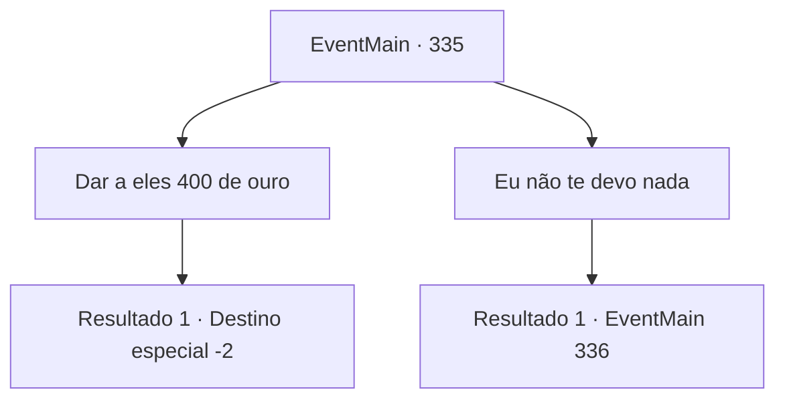

# Eventos principais · 335

[Índice da tabela](index.md) · [Índice geral](../index.md)

ID: `pt:EventMain:335` · Fonte: `EventMain4` · Versão: 1.2.47.

Mapeamento estático dos arquivos; a disponibilidade e a execução dependem do estado da run.

## Texto do evento

*Sem texto no arquivo.*

## Dados de entrada

```json
{
  "id": 335,
  "grade": 1,
  "normalGoal": "",
  "required": ""
}
```

## Mapa das escolhas



## Escolhas e resultados

### Escolha 1

Dar a eles 400 de ouro

Requisitos e outros campos da escolha:

```json
{
  "required": "1_4_400"
}
```

#### Resultado 1.1

Você decide pagar uma parte de sua dívida primeiro. Os cobradores de dívidas dão um sorriso, satisfeitos, pegam o ouro e vão embora.

Continuação registrada: [Destino especial `-2`](../destinos-especiais.md).

```json
{
  "required": "",
  "chance": "1",
  "nextEvent": -2,
  "type": 2,
  "reward": "13_3_8|0_4_-400|0_2_1|5_244_0"
}
```

### Escolha 2

Eu não te devo nada

Requisitos e outros campos da escolha:

```json
{
  "required": "2_4_400"
}
```

#### Resultado 2.1

Você diz que não deve nada a eles. Um dos cobradores de dívidas cruza os braços e geme. 

 "Hmm .. Isso vai tornar a vida da sua irmã muito mais difícil ... Que pena."

 

Continuação registrada: [Evento 336](0336.md) na mesma tabela.

```json
{
  "required": "",
  "chance": "1",
  "nextEvent": 336,
  "type": 2,
  "reward": ""
}
```

## Referências que chegam a este evento

- [Evento 334 · escolha 1 · resultado 1](0334.md#escolha-1)
- [Evento 334 · escolha 2 · resultado 1](0334.md#escolha-2)
- [Evento 334 · escolha 2 · resultado 2](0334.md#escolha-2)
