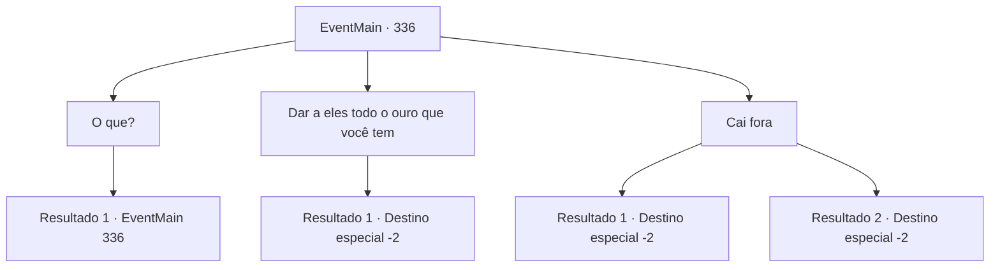

# Eventos principais · 336

[Índice da tabela](index.md) · [Índice geral](../index.md)

ID: `pt:EventMain:336` · Fonte: `EventMain4` · Versão: 1.2.47.

Mapeamento estático dos arquivos; a disponibilidade e a execução dependem do estado da run.

## Texto do evento

*Sem texto no arquivo.*

## Dados de entrada

```json
{
  "id": 336,
  "grade": 1,
  "normalGoal": "",
  "required": ""
}
```

## Mapa das escolhas



## Escolhas e resultados

### Escolha 1

O que?

Requisitos e outros campos da escolha:

```json
{
  "required": "5_252_0"
}
```

#### Resultado 1.1


 "Cara, você faz muitas perguntas. Olha, se você não pode pagar a dívida, pare de ser tão chato. Isso significa que sua irmã vai trabalhar muito mais para pagar a dívida, só isso."

 O cobrador de dívidas resmunga.

Continuação registrada: [Evento 336](0336.md) na mesma tabela.

```json
{
  "required": "",
  "chance": "1",
  "nextEvent": 336,
  "type": 2,
  "reward": "5_252_1"
}
```

### Escolha 2

Dar a eles todo o ouro que você tem

Requisitos e outros campos da escolha:

```json
{
  "required": ""
}
```

#### Resultado 2.1

Você dá aos cobradores de dívidas todo o ouro que você tem, dizendo a eles para entregá-lo a Anton. Eles dão uma olhada dentro da bolsa que você deu a eles e acenam com a cabeça. Eles pegam o ouro e vão embora.

Continuação registrada: [Destino especial `-2`](../destinos-especiais.md).

```json
{
  "required": "",
  "chance": "1",
  "nextEvent": -2,
  "type": 2,
  "reward": "13_3_8|0_4_-400|0_2_1"
}
```

### Escolha 3

Cai fora

Requisitos e outros campos da escolha:

```json
{
  "required": ""
}
```

#### Resultado 3.1

Você grita com os cobradores de dívidas para irem embora. Eles dão de ombros e vão embora.

Continuação registrada: [Destino especial `-2`](../destinos-especiais.md).

```json
{
  "required": "5_244_0",
  "chance": "1",
  "nextEvent": -2,
  "type": 2,
  "reward": "13_3_8|5_244_1|0_2_1"
}
```

#### Resultado 3.2

Você grita com os cobradores de dívidas para irem embora. Eles dão de ombros e vão embora.

Continuação registrada: [Destino especial `-2`](../destinos-especiais.md).

```json
{
  "required": "5_244_1",
  "chance": "1",
  "nextEvent": -2,
  "type": 2,
  "reward": "13_3_8|5_244_2|0_2_1"
}
```

## Referências que chegam a este evento

- [Evento 335 · escolha 2 · resultado 1](0335.md#escolha-2)
- [Evento 336 · escolha 1 · resultado 1](0336.md#escolha-1)
