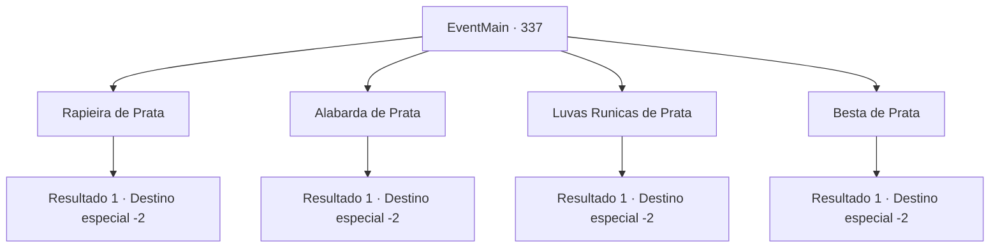

# Eventos principais · 337

[Índice da tabela](index.md) · [Índice geral](../index.md)

ID: `pt:EventMain:337` · Fonte: `EventMain4` · Versão: 1.2.47.

Mapeamento estático dos arquivos; a disponibilidade e a execução dependem do estado da run.

## Texto do evento

*Sem texto no arquivo.*

## Dados de entrada

```json
{
  "id": 337,
  "grade": 1,
  "normalGoal": "",
  "required": ""
}
```

## Mapa das escolhas



## Escolhas e resultados

### Escolha 1

Rapieira de Prata

Requisitos e outros campos da escolha:

```json
{
  "required": ""
}
```

#### Resultado 1.1

Você pega o florete feito de prata, junto com um punhado de ouro, e sai silenciosamente da taverna. Você então segue para a 'Floresta de Caripps', o lugar onde os caçadores supostamente perderam suas presas.

Continuação registrada: [Destino especial `-2`](../destinos-especiais.md).

```json
{
  "required": "",
  "chance": "1",
  "nextEvent": -2,
  "type": 2,
  "reward": "13_3_3|3_102_1|0_4_95|0_2_1"
}
```

### Escolha 2

Alabarda de Prata

Requisitos e outros campos da escolha:

```json
{
  "required": ""
}
```

#### Resultado 2.1

Você pega a alabarda feita de prata, junto com um punhado de ouro, e sai silenciosamente da taverna. Você então segue para a 'Floresta de Caripps', o lugar onde os caçadores supostamente perderam suas presas.

Continuação registrada: [Destino especial `-2`](../destinos-especiais.md).

```json
{
  "required": "",
  "chance": "1",
  "nextEvent": -2,
  "type": 2,
  "reward": "13_3_3|3_229_1|0_4_40|0_2_1"
}
```

### Escolha 3

Luvas Runicas de Prata

Requisitos e outros campos da escolha:

```json
{
  "required": ""
}
```

#### Resultado 3.1

Você pega a luva rúnica feita de prata, junto com um punhado de ouro, e sai silenciosamente da taverna. Você então segue para a 'Floresta de Caripps', o lugar onde os caçadores supostamente perderam suas presas.

Continuação registrada: [Destino especial `-2`](../destinos-especiais.md).

```json
{
  "required": "",
  "chance": "1",
  "nextEvent": -2,
  "type": 2,
  "reward": "13_3_3|3_227_1|0_4_85|0_2_1"
}
```

### Escolha 4

Besta de Prata

Requisitos e outros campos da escolha:

```json
{
  "required": ""
}
```

#### Resultado 4.1

Você pega a besta feita de prata, junto com um punhado de ouro, e sai silenciosamente da taverna. Você então segue para a 'Floresta de Caripps, o lugar onde os caçadores supostamente perderam suas presas.

Continuação registrada: [Destino especial `-2`](../destinos-especiais.md).

```json
{
  "required": "",
  "chance": "1",
  "nextEvent": -2,
  "type": 2,
  "reward": "13_3_3|3_228_1|0_4_30|0_2_1"
}
```

## Referências que chegam a este evento

- [Evento 312 · escolha 2 · resultado 1](0312.md#escolha-2)
- [Evento 312 · escolha 2 · resultado 2](0312.md#escolha-2)
