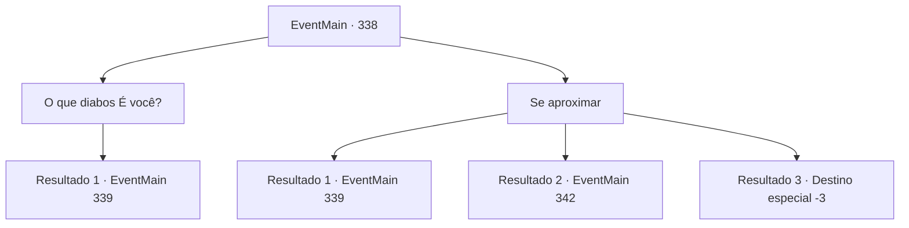

# Eventos principais · 338

[Índice da tabela](index.md) · [Índice geral](../index.md)

ID: `pt:EventMain:338` · Fonte: `EventMain4` · Versão: 1.2.47.

Mapeamento estático dos arquivos; a disponibilidade e a execução dependem do estado da run.

## Texto do evento

Você chega a 'Floresta Caripps', onde os caçadores de vampiros supostamente perderam suas presas. É uma floresta de coníferas, onde o uivo do vento lembra os sons dos gritos humanos. Você caminha cuidadosamente para a floresta escura passo a passo, suando profusamente.

 Há quanto tempo você está andando na floresta. Vampiros não aparecem de jeito nenhum, e você está cansado de tanto andar. Então você se senta em um toco e relaxa um pouco. Então, uma mulher aparece. 

 "Oh meu... Nesta floresta profunda... O que você está fazendo?"

 Ela se aproxima de você com um olhar cativante.

## Dados de entrada

```json
{
  "id": 338,
  "grade": 1,
  "normalGoal": "",
  "required": "13_3_3|1_2_15"
}
```

## Mapa das escolhas



## Escolhas e resultados

### Escolha 1

O que diabos É você?

Requisitos e outros campos da escolha:

```json
{
  "required": "1_14_15"
}
```

#### Resultado 1.1

Você sente como se o olhar dela estivesse segurando e sacudindo sua mente. É realmente desagradável. Você balança a cabeça e pergunta o que ela realmente é. Depois de ouvir isso, seus olhos encantadores se transformam em um olhar mortal. 

 "Ugh, é exatamente por isso que eu odeio crianças inteligentes..."

 Assim que ela termina de falar, seus olhos brilhantes voam na sua direção. 

Continuação registrada: [Evento 339](0339.md) na mesma tabela.

```json
{
  "required": "",
  "chance": "1",
  "nextEvent": 339,
  "type": 2,
  "reward": "6_0_123",
  "place": 1
}
```

### Escolha 2

Se aproximar

Requisitos e outros campos da escolha:

```json
{
  "required": "2_14_15"
}
```

#### Resultado 2.1

Você está completamente encantado com o olhar dela. Sem nem perceber, você caminha em direção a ela. Então, suas mãos frias deslizam para baixo, cruzando seu rosto e pousando em seus ombros. Um par de dentes afiados afunda em seu pescoço. Você logo percebe o que está acontecendo. Você reúne todas as suas forças para afastá-la, mas ela aperta seu aperto em você com uma força incrível, drenando seu sangue cada vez mais. Pouco antes de perder a consciência você consegue acertar um golpe na cabeça dela, ela vacila e cai para trás, mas logo pula de volta em sua direção.

Continuação registrada: [Evento 339](0339.md) na mesma tabela.

```json
{
  "required": "1_0_2|23_2_1",
  "chance": "1",
  "nextEvent": 339,
  "type": 2,
  "reward": "0_0_-1|6_2_123",
  "place": 1
}
```

#### Resultado 2.2

Você está completamente encantado com o olhar dela. Sem nem perceber, você caminha em direção a ela. Então, suas mãos frias deslizam para baixo, cruzando seu rosto e pousando em seus ombros. Um par de dentes afiados afunda em seu pescoço. Você logo percebe o que está acontecendo e tenta empurrá-la para longe, mas com uma força incrível ela apertaainda mais e começa a chupar seu sangue. Nesse momento, um raio de prata atravessa a escuridão, partindo o pescoço da mulher. |drawing_ashenVamp| Seu corpo queima em uma pilha de cinzas. Os caçadores de vampiros correm até você para prestar ajuda, então rapidamente recolhem as cinzas. 

 "Chegamos perto de criar outra vítima. Você está bem?"

 O caçador com um tapa-olho ajuda você a se levantar.

Continuação registrada: [Evento 342](0342.md) na mesma tabela.

```json
{
  "required": "1_0_2|24_2_1",
  "chance": "1",
  "nextEvent": 342,
  "type": 2,
  "reward": "0_0_-1"
}
```

#### Resultado 2.3

Você está completamente encantado com o olhar dela. Sem nem perceber, você caminha em direção a ela. Então, suas mãos frias deslizam para baixo, cruzando seu rosto e pousando em seus ombros. Um par de dentes afiados afunda em seu pescoço. Você logo percebe o que está acontecendo. Você reúne todas as suas forças para afastá-la, mas como uma força quase sobrenatural ela te aperta ainda mais, drenando seu sangue cada vez mais. Você perde a consciência e entra em colapso.

Continuação registrada: [Destino especial `-3`](../destinos-especiais.md).

```json
{
  "required": "2_0_2",
  "chance": "1",
  "nextEvent": -3,
  "type": 2,
  "reward": "0_0_-1"
}
```

## Referências que chegam a este evento

Nenhum `nextEvent` positivo da mesma tabela aponta para este nó. Isso não prova que seja inacessível: sorteio e estado de história podem selecioná-lo.

