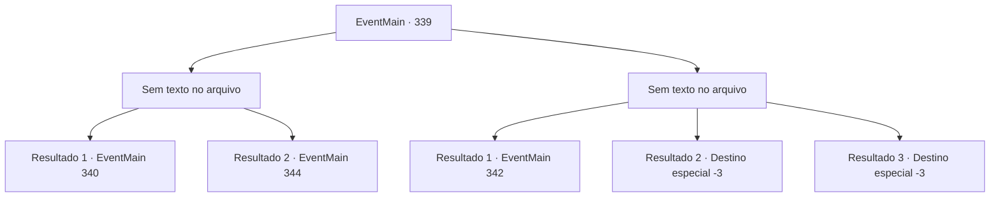

# Eventos principais · 339

[Índice da tabela](index.md) · [Índice geral](../index.md)

ID: `pt:EventMain:339` · Fonte: `EventMain4` · Versão: 1.2.47.

Mapeamento estático dos arquivos; a disponibilidade e a execução dependem do estado da run.

## Texto do evento

*Sem texto no arquivo.*

## Dados de entrada

```json
{
  "id": 339,
  "grade": 1,
  "normalGoal": "",
  "required": ""
}
```

## Mapa das escolhas



## Escolhas e resultados

### Escolha 1

*Sem texto no arquivo; o papel dessa opção depende da interface do jogo.*

Requisitos e outros campos da escolha:

```json
{
  "required": ""
}
```

#### Resultado 1.1

Você separa a cabeça da vampira do corpo dela. |drawing_ashenVamp| Seu corpo queima em uma pilha de cinzas. Você se agacha e recolhe as cinzas você mesmo. Você faz uma pequena pausa e decide procurar uma igreja.

Continuação registrada: [Evento 340](0340.md) na mesma tabela.

```json
{
  "required": "23_2_1",
  "chance": "1",
  "nextEvent": 340,
  "type": 2,
  "reward": ""
}
```

#### Resultado 1.2

Você derrota o vampiro. Mas ele lentamente começa a se levantar, contorcendo seu corpo de maneira grotesca. Ele ataca você novamente. Mas então, um raio de prata vem voando da escuridão e perfura a cabeça do vampiro. |drawing_ashenVamp| Seu corpo inteiro queima, terminando como uma pilha de cinzas. Os caçadores de vampiros correm rapidamente para você e verificam seus ferimentos. 

 "Vampiros são criaturas perigosas. Espero que não tente levá-los sozinho da próxima vez. Mas... você parece ter aptidão para se tornar um caçador de vampiros."

 Ele recolhe as cinzas do vampiro e continua. 

 "O que você disse? Você estaria disposto a ajudar a se livrar dos vampiros?"


Continuação registrada: [Evento 344](0344.md) na mesma tabela.

```json
{
  "required": "24_2_1",
  "chance": "1",
  "nextEvent": 344,
  "type": 2,
  "reward": ""
}
```

### Escolha 2

*Sem texto no arquivo; o papel dessa opção depende da interface do jogo.*

Requisitos e outros campos da escolha:

```json
{
  "required": ""
}
```

#### Resultado 2.1

Você luta contra a vampira, mas não é páreo para ela. Ela aperta seu rosto com as mãos frias. Foi nesse momento, quando um raio de prata vem voando pela escuridão e perfura o pescoço da mulher. |drawing_ashenVamp| Seu corpo queima em uma pilha de cinzas. Os caçadores de vampiros correm até você para prestar ajuda, então rapidamente recolhem as cinzas. 

 "Chegamos perto de criar outra vítima. Você está bem?"

 O caçador com um tapa-olho ajuda você a se levantar.

Continuação registrada: [Evento 342](0342.md) na mesma tabela.

```json
{
  "required": "1_0_2|1_1_2",
  "chance": "1",
  "nextEvent": 342,
  "type": 2,
  "reward": "0_0_-1|0_1_-1"
}
```

#### Resultado 2.2

Você luta contra o vampiro, mas não adianta. Suas mãos frias pousam em seu rosto. O aperto para ficar gradualmente mais forte enquanto os dentes afundam em seu pescoço. Você perde a consciência ao sentir o sangue sendo drenado de suas veias.

Continuação registrada: [Destino especial `-3`](../destinos-especiais.md).

```json
{
  "required": "2_0_2",
  "chance": "1",
  "nextEvent": -3,
  "type": 2,
  "reward": "0_0_-1|0_1_-1"
}
```

#### Resultado 2.3

Você luta contra o vampiro, mas não adianta. Suas mãos frias pousam em seu rosto. O aperto para ficar gradualmente mais forte enquanto os dentes afundam em seu pescoço. Você perde a consciência ao sentir o sangue sendo drenado de suas veias.

Continuação registrada: [Destino especial `-3`](../destinos-especiais.md).

```json
{
  "required": "2_1_2",
  "chance": "1",
  "nextEvent": -3,
  "type": 2,
  "reward": "0_0_-1|0_1_-1"
}
```

## Referências que chegam a este evento

- [Evento 338 · escolha 1 · resultado 1](0338.md#escolha-1)
- [Evento 338 · escolha 2 · resultado 1](0338.md#escolha-2)
