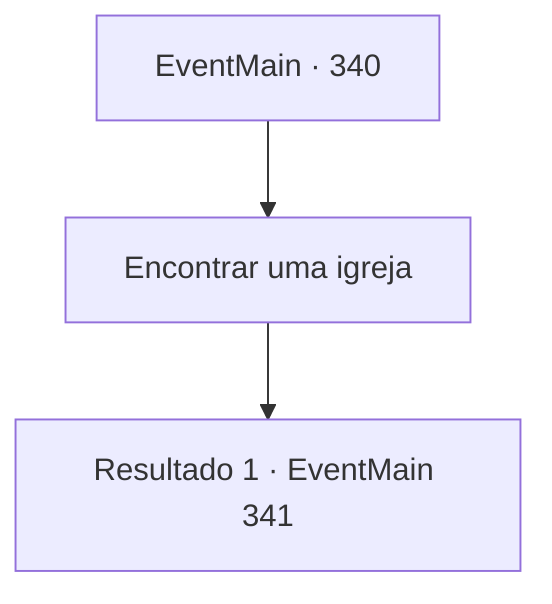

# Eventos principais · 340

[Índice da tabela](index.md) · [Índice geral](../index.md)

ID: `pt:EventMain:340` · Fonte: `EventMain4` · Versão: 1.2.47.

Mapeamento estático dos arquivos; a disponibilidade e a execução dependem do estado da run.

## Texto do evento

*Sem texto no arquivo.*

## Dados de entrada

```json
{
  "id": 340,
  "grade": 1,
  "normalGoal": "",
  "required": ""
}
```

## Mapa das escolhas



## Escolhas e resultados

### Escolha 1

Encontrar uma igreja

Requisitos e outros campos da escolha:

```json
{
  "required": ""
}
```

#### Resultado 1.1

Você vai para a cidade mais próxima. A cidade, chamada 'Gleesee', tem uma pequena igreja. Quando você bate na porta da igreja, um senhor muito velho de cabelos grisalhos o cumprimenta. 

 "Posso ajudar..?"

 Antes que você possa responder, ele percebe os ferimentos em seu pescoço e gesticula para você entrar. O traz uma tigela de prata com água e limpa sua ferida com ela. Bolhas se formam em suas feridas e depois desaparecem rapidamente. 

 "Você deve ter lutado com um vampiro... O que aconteceu com esse vampiro, posso perguntar?"

 Você mostra a ele as cinzas do vampiro. Ele a observa com uma lupa e sorri. 

 "Incrível. A propósito... por acaso você viu um grupo de caçadores de vampiros?"

 

Continuação registrada: [Evento 341](0341.md) na mesma tabela.

```json
{
  "required": "",
  "chance": "1",
  "nextEvent": 341,
  "type": 2,
  "reward": "0_0_1"
}
```

## Referências que chegam a este evento

- [Evento 339 · escolha 1 · resultado 1](0339.md#escolha-1)
