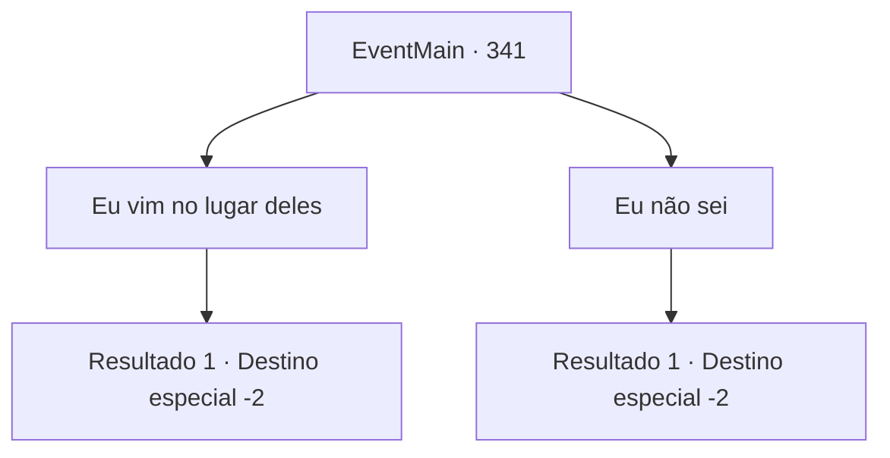

# Eventos principais · 341

[Índice da tabela](index.md) · [Índice geral](../index.md)

ID: `pt:EventMain:341` · Fonte: `EventMain4` · Versão: 1.2.47.

Mapeamento estático dos arquivos; a disponibilidade e a execução dependem do estado da run.

## Texto do evento

*Sem texto no arquivo.*

## Dados de entrada

```json
{
  "id": 341,
  "grade": 1,
  "normalGoal": "",
  "required": ""
}
```

## Mapa das escolhas



## Escolhas e resultados

### Escolha 1

Eu vim no lugar deles

Requisitos e outros campos da escolha:

```json
{
  "required": "1_14_12"
}
```

#### Resultado 1.1

Você diz a ele que veio no lugar deles. O velho padre assente e fala. 

 "Entendo. Estamos sempre agradecidos pelo trabalho deles. Por favor, mande meus cumprimentos aos Mercenários de Ziwa, em 'Illaha Island'."

 Depois de terminar, ele lhe dá uma bolsa cheia de ouro. Você se despede do padre e sai da igreja. Agora você sabe onde fica a sede dos mercenários. Você tem um novo objetivo - encontrar uma maneira de chegar à Ilha Illaha.

Continuação registrada: [Destino especial `-2`](../destinos-especiais.md).

```json
{
  "required": "",
  "chance": "1",
  "nextEvent": -2,
  "type": 2,
  "reward": "0_4_200|13_3_5|0_2_1"
}
```

### Escolha 2

Eu não sei

Requisitos e outros campos da escolha:

```json
{
  "required": ""
}
```

#### Resultado 2.1

Você diz a ele que não viu nenhuma pessoa desse tipo. O padre responde que algo pode ter acontecido com eles. De qualquer forma, você pega a recompensa e sai da igreja.

Continuação registrada: [Destino especial `-2`](../destinos-especiais.md).

```json
{
  "required": "",
  "chance": "1",
  "nextEvent": -2,
  "type": 2,
  "reward": "0_4_200|13_3_11|0_2_1"
}
```

## Referências que chegam a este evento

- [Evento 340 · escolha 1 · resultado 1](0340.md#escolha-1)
