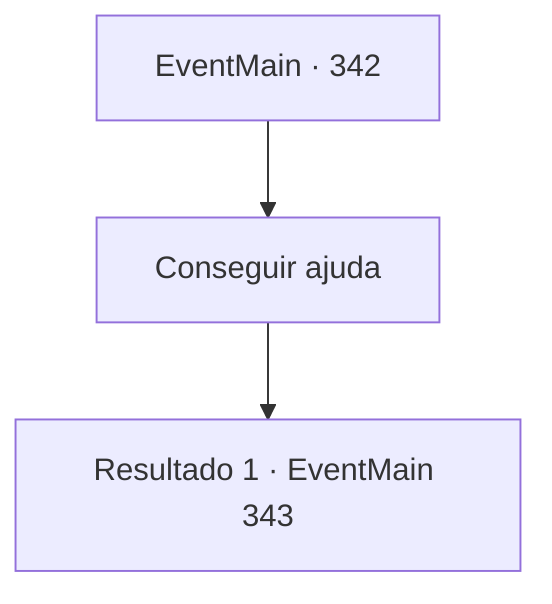

# Eventos principais · 342

[Índice da tabela](index.md) · [Índice geral](../index.md)

ID: `pt:EventMain:342` · Fonte: `EventMain4` · Versão: 1.2.47.

Mapeamento estático dos arquivos; a disponibilidade e a execução dependem do estado da run.

## Texto do evento

*Sem texto no arquivo.*

## Dados de entrada

```json
{
  "id": 342,
  "grade": 1,
  "normalGoal": "",
  "required": ""
}
```

## Mapa das escolhas



## Escolhas e resultados

### Escolha 1

Conseguir ajuda

Requisitos e outros campos da escolha:

```json
{
  "required": ""
}
```

#### Resultado 1.1

Você e os caçadores de vampiros chegam a uma igreja em uma cidade chamada 'Gleesee'. A primeira coisa que os caçadores fazem é levá-lo ao padre, pedindo uma cura. 

 "Por aqui."

 O padre traz uma tigela de prata cheia de água e limpa suas feridas com essa água. Bolhas se formam nas feridas e desaparecem rapidamente. Enquanto você está colocando bandagens, o padre e os caçadores conversam.

Continuação registrada: [Evento 343](0343.md) na mesma tabela.

```json
{
  "required": "",
  "chance": "1",
  "nextEvent": 343,
  "type": 2,
  "reward": "0_0_1"
}
```

## Referências que chegam a este evento

- [Evento 338 · escolha 2 · resultado 2](0338.md#escolha-2)
- [Evento 339 · escolha 2 · resultado 1](0339.md#escolha-2)
