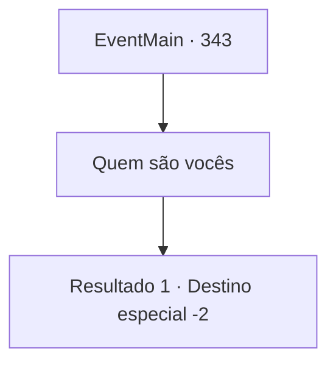

# Eventos principais · 343

[Índice da tabela](index.md) · [Índice geral](../index.md)

ID: `pt:EventMain:343` · Fonte: `EventMain4` · Versão: 1.2.47.

Mapeamento estático dos arquivos; a disponibilidade e a execução dependem do estado da run.

## Texto do evento

*Sem texto no arquivo.*

## Dados de entrada

```json
{
  "id": 343,
  "grade": 1,
  "normalGoal": "",
  "required": ""
}
```

## Mapa das escolhas



## Escolhas e resultados

### Escolha 1

Quem são vocês

Requisitos e outros campos da escolha:

```json
{
  "required": ""
}
```

#### Resultado 1.1

Você pergunta a eles quem eles são. O padre responde, em vez disso, de uma maneira muito suave. 

 "Ah, esses são os estimados caçadores de vampiros dos Mercenários Ziwa."

 Então, o homem com um tapa-olho fala. 

 "Você deseja se tornar um caçador de vampiros como nós? Bem... depois de ver o mal com os próprios olhos, faz sentido querer ser capaz de lutar contra ele. Procure a 'Ilha de Illaha'."

 Você tem um novo objetivo - encontrar uma maneira de chegar à Ilha Illaha.

Continuação registrada: [Destino especial `-2`](../destinos-especiais.md).

```json
{
  "required": "",
  "chance": "1",
  "nextEvent": -2,
  "type": 2,
  "reward": "13_3_5|0_2_1"
}
```

## Referências que chegam a este evento

- [Evento 342 · escolha 1 · resultado 1](0342.md#escolha-1)
