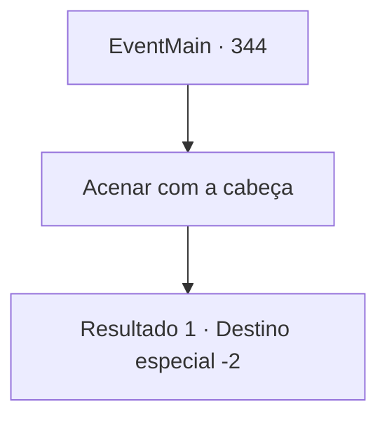

# Eventos principais · 344

[Índice da tabela](index.md) · [Índice geral](../index.md)

ID: `pt:EventMain:344` · Fonte: `EventMain4` · Versão: 1.2.47.

Mapeamento estático dos arquivos; a disponibilidade e a execução dependem do estado da run.

## Texto do evento

*Sem texto no arquivo.*

## Dados de entrada

```json
{
  "id": 344,
  "grade": 1,
  "normalGoal": "",
  "required": ""
}
```

## Mapa das escolhas



## Escolhas e resultados

### Escolha 1

Acenar com a cabeça

Requisitos e outros campos da escolha:

```json
{
  "required": ""
}
```

#### Resultado 1.1

Você responde com um aceno de cabeça. Então o caçador que falou com você bate em seus ombros, rindo. 

 "HAHA!! Eu gosto da sua atitude. Vamos para a igreja por enquanto. Nós pegamos um vampiro, é hora de ser pago!"

 Você chega à igreja localizada em uma cidade chamada 'Gleesee', junto com os caçadores de vampiros. Um jovem padre dá as boas-vindas a você e aos caçadores. 

 "Hm... Estas são, sem dúvida, cinzas de vampiros. Um trabalho bem feito. A igreja agradece."

 O padre paga aos caçadores e você também recebe sua parte do pagamento. 

Continuação registrada: [Destino especial `-2`](../destinos-especiais.md).

```json
{
  "required": "",
  "chance": "1",
  "nextEvent": -2,
  "type": 2,
  "reward": "0_4_100|13_3_5|3_226_1|0_2_1"
}
```

## Referências que chegam a este evento

- [Evento 339 · escolha 1 · resultado 2](0339.md#escolha-1)
