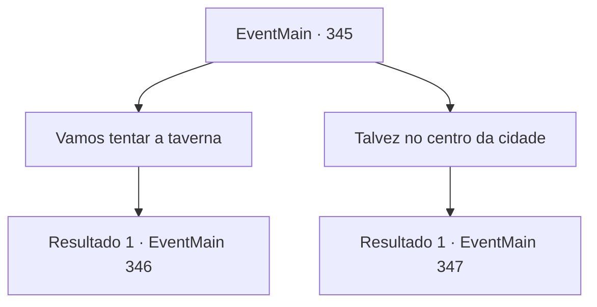

# Eventos principais · 345

[Índice da tabela](index.md) · [Índice geral](../index.md)

ID: `pt:EventMain:345` · Fonte: `EventMain4` · Versão: 1.2.47.

Mapeamento estático dos arquivos; a disponibilidade e a execução dependem do estado da run.

## Texto do evento

|drawing_romb| Você chega em 'Romb'. É uma cidade construída sobre um enorme penhasco rochoso da costa. O nevoeiro do mar e a chuva fazem parte do dia-a-dia das pessoas de Romb. Pela aparência, o lugar parece ser horrível para se viver, mas o tamanho da cidade é incrível. Quando você entra, percebe que é ainda maior e mais populoso do que parecia do lado de fora. Você pode ver um enorme estádio cheio de pistas para corridas de cavalos e um grande coliseu ao lado. Ao lado da rua principal estão bordéis e pubs. Parado na entrada da cidade, você pensa sobre onde começar sua busca pelo vampiro.

## Dados de entrada

```json
{
  "id": 345,
  "grade": 1,
  "normalGoal": "",
  "required": "13_3_8|1_2_75"
}
```

## Mapa das escolhas



## Escolhas e resultados

### Escolha 1

Vamos tentar a taverna

Requisitos e outros campos da escolha:

```json
{
  "required": ""
}
```

#### Resultado 1.1

Você entra em uma taverna de três andares, localizada perto do coliseu. Há cartazes sobre o torneio em todas as paredes e cantos. As mesas estão cheias de pessoas debatendo sobre quem vai ganhar. 

 "Ah, seu cérebro de bode ..! Obviamente, o vencedor será 'Karlievich, o Punho Vermelho'!"

 "Não não. A estrela em ascensão, o 'Esquilo', será o vencedor."

 Você tenta passar por eles enquanto escuta. Mas então, um nome familiar o impede. 

 "Ah, Fiana? Ouvi dizer que ela está quieta hoje em dia."

 Fiana. Assim que você ouve esse nome, você vira seu olhar para o pôster do torneio nas paredes. Você reconhece o rosto de sua irmã desenhado nele. Aparentemente, ela está prestes a participar de um duelo. Você se aproxima da mesa.

Continuação registrada: [Evento 346](0346.md) na mesma tabela.

```json
{
  "required": "",
  "chance": "1",
  "nextEvent": 346,
  "type": 2,
  "reward": ""
}
```

### Escolha 2

Talvez no centro da cidade

Requisitos e outros campos da escolha:

```json
{
  "required": ""
}
```

#### Resultado 2.1

Você vê um quadro de avisos na praça da cidade. Um cartaz sobre a luta no coliseu é colocado no quadro. A programação do torneio é preenchida com os retratos e nomes dos participantes. Você vê o nome 'Fiana' e um desenho de um rosto familiar. Este é, sem dúvida, o nome de sua irmã que está sendo mantida em cativeiro. Então, um homem vestindo roupas sujas se aproxima e fala com você. Ele arregaça as mangas, mostra uma braçadeira com o logotipo da Ziwa Mercenaries inscrito. Você decide seguir o estranho para um lugar menos movimentado. 

 "Prazer em conhecê-lo, {1}. Meu nome é 'Luan de Alfons'. 'Luan' é o suficiente. Cheguei aqui algumas semanas atrás, procurando por sinais de vampiros."

 Depois de se apresentar, Luan lhe diz que há algo errado com o pessoal do coliseu.

Continuação registrada: [Evento 347](0347.md) na mesma tabela.

```json
{
  "required": "",
  "chance": "1",
  "nextEvent": 347,
  "type": 2,
  "reward": ""
}
```

## Referências que chegam a este evento

Nenhum `nextEvent` positivo da mesma tabela aponta para este nó. Isso não prova que seja inacessível: sorteio e estado de história podem selecioná-lo.

