# Eventos principais · 346

[Índice da tabela](index.md) · [Índice geral](../index.md)

ID: `pt:EventMain:346` · Fonte: `EventMain4` · Versão: 1.2.47.

Mapeamento estático dos arquivos; a disponibilidade e a execução dependem do estado da run.

## Texto do evento

*Sem texto no arquivo.*

## Dados de entrada

```json
{
  "id": 346,
  "grade": 1,
  "normalGoal": "",
  "required": ""
}
```

## Mapa das escolhas

```mermaid
flowchart TD
  E["EventMain · 346"]
  C0["Perguntar sobre o &#x27;Esquilo&#x27;"]
  E --> C0
  R0_0["Resultado 1 · EventMain 346"]
  C0 --> R0_0
  R0_1["Resultado 2 · EventMain 346"]
  C0 --> R0_1
  R0_2["Resultado 3 · EventMain 346"]
  C0 --> R0_2
  C1["Perguntar mais sobre vampiros"]
  E --> C1
  R1_0["Resultado 1 · EventMain 346"]
  C1 --> R1_0
  C2["Como eu vejo os participantes"]
  E --> C2
  R2_0["Resultado 1 · EventMain 348"]
  C2 --> R2_0
```



## Escolhas e resultados

### Escolha 1

Perguntar sobre o 'Esquilo'

Requisitos e outros campos da escolha:

```json
{
  "required": "5_253_0"
}
```

#### Resultado 1.1

Você faz mais perguntas sobre este 'Esquilo'. O careca, que supostamente apostou seu dinheiro no Esquilo, responde. 

 "Hm.. Ela é baixinha e pequena, mas seus olhos verdes afiados e brilhantes dão a ela uma vibração intimidadora. Ela parece ser uma lutadora naturalmente talentosa também... Ela vai vencer essa sem dúvida. O 'Punho Vermelho' tem uma pancada imcomparával."

 O outro homem responde dizendo-lhe para não se arrepender de não ter apostado no Punho Vermelho.

Continuação registrada: [Evento 346](0346.md) na mesma tabela.

```json
{
  "required": "5_244_0",
  "chance": "1",
  "nextEvent": 346,
  "type": 2,
  "reward": "5_253_1"
}
```

#### Resultado 1.2

Você faz mais perguntas sobre este 'Esquilo'. O careca, que supostamente apostou seu dinheiro no Esquilo, responde. 

 "Hm.. Ela é baixinha e pequena, mas seus olhos verdes afiados e brilhantes dão a ela uma vibração intimidadora. Ela parece ser uma lutadora naturalmente talentosa, sem mencionar que ela parece estar ficando mais forte a cada dia. Mas o 'Punho Vermelho' tem uma pancada incompáravel."

 O outro homem responde dizendo-lhe para não se arrepender de não ter apostado no Punho Vermelho.

Continuação registrada: [Evento 346](0346.md) na mesma tabela.

```json
{
  "required": "5_244_1",
  "chance": "1",
  "nextEvent": 346,
  "type": 2,
  "reward": "5_253_1"
}
```

#### Resultado 1.3

Você faz mais perguntas sobre este 'Esquilo'. O homem gordinho, que supostamente apostou seu dinheiro no Punho Vermelho, responde. 

 "Bem... ela é uma boa lutadora, sem dúvidas. Mas ela tem participado de muitos duelos consecutivamente, e o cansaço vai alcançar ela logo logo."

 O outro homem responde dizendo-lhe para não se arrepender de não ter apostado no Esquilo.

Continuação registrada: [Evento 346](0346.md) na mesma tabela.

```json
{
  "required": "5_244_2",
  "chance": "1",
  "nextEvent": 346,
  "type": 2,
  "reward": "5_253_1"
}
```

### Escolha 2

Perguntar mais sobre vampiros

Requisitos e outros campos da escolha:

```json
{
  "required": "5_254_0"
}
```

#### Resultado 2.1

Você se lembra por que veio para esta cidade em primeiro lugar. Você pergunta se eles ouviram falar de rumores de vampiros. Mas eles dizem que não.

Continuação registrada: [Evento 346](0346.md) na mesma tabela.

```json
{
  "required": "",
  "chance": "1",
  "nextEvent": 346,
  "type": 2,
  "reward": "5_254_1"
}
```

### Escolha 3

Como eu vejo os participantes

Requisitos e outros campos da escolha:

```json
{
  "required": "5_253_1"
}
```

#### Resultado 3.1

Você pergunta a eles onde encontrar os participantes cara a cara. Eles reviram os olhos um pouco antes de responder. 

 "Quem sabe. Eles devem estar em algum lugar dentro do coliseu."

 Você ouve a resposta e caminha imediatamente em direção ao Coliseu.

 O Coliseu está estranhamente quieto sob a luz do dia. O silêncio enche o ar. Ao entrar no coliseu, um corredor estreito e alto aparece. Você encontra um golem no meio do corredor. 

 "Volte. O coliseu... ainda não abriu. Volte quando o sol se puser."


Continuação registrada: [Evento 348](0348.md) na mesma tabela.

```json
{
  "required": "",
  "chance": "1",
  "nextEvent": 348,
  "type": 2,
  "reward": "5_254_1"
}
```

## Referências que chegam a este evento

- [Evento 345 · escolha 1 · resultado 1](0345.md#escolha-1)
- [Evento 346 · escolha 1 · resultado 1](0346.md#escolha-1)
- [Evento 346 · escolha 1 · resultado 2](0346.md#escolha-1)
- [Evento 346 · escolha 1 · resultado 3](0346.md#escolha-1)
- [Evento 346 · escolha 2 · resultado 1](0346.md#escolha-2)
