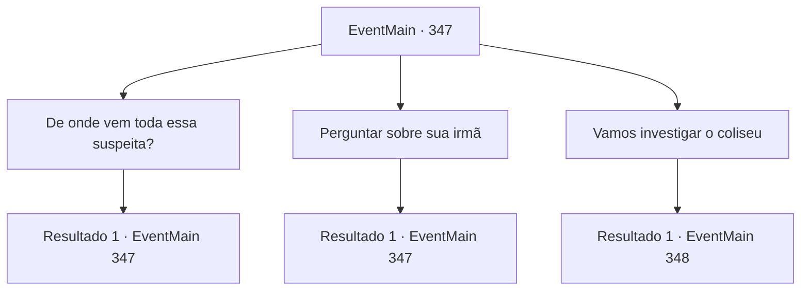

# Eventos principais · 347

[Índice da tabela](index.md) · [Índice geral](../index.md)

ID: `pt:EventMain:347` · Fonte: `EventMain4` · Versão: 1.2.47.

Mapeamento estático dos arquivos; a disponibilidade e a execução dependem do estado da run.

## Texto do evento

*Sem texto no arquivo.*

## Dados de entrada

```json
{
  "id": 347,
  "grade": 1,
  "normalGoal": "",
  "required": ""
}
```

## Mapa das escolhas



## Escolhas e resultados

### Escolha 1

De onde vem toda essa suspeita?

Requisitos e outros campos da escolha:

```json
{
  "required": "5_255_0"
}
```

#### Resultado 1.1

Você pergunta a Luan o motivo das suspeitas. Luan te responde imediatamente. 

 "O coliseu só abre à noite. Antes disso, um golem gigante guarda o caminho. E eu tive a chance de encontrar o operador do coliseu durante uma luta..."

 Luan para brevemente e continua com a voz mais baixa. 

 "Senti um leve cheiro de sangue. Então eu suspeito que o operador, e possivelmente seus subordinados também, sejam vampiros. Eles provavelmente fizeram seu esconderijo nas profundezas do coliseu."


Continuação registrada: [Evento 347](0347.md) na mesma tabela.

```json
{
  "required": "",
  "chance": "1",
  "nextEvent": 347,
  "type": 2,
  "reward": "5_255_1"
}
```

### Escolha 2

Perguntar sobre sua irmã

Requisitos e outros campos da escolha:

```json
{
  "required": "5_253_0"
}
```

#### Resultado 2.1

Você pergunta a ele se ele sabe alguma coisa sobre sua irmã. Mas ele balança a cabeça e responde. 

 "Eu sinto Muito. Eu definitivamente já ouvi falar desse nome, mas é isso. Se ela está participando das lutas, ela provavelmente está naquele coliseu também."


Continuação registrada: [Evento 347](0347.md) na mesma tabela.

```json
{
  "required": "",
  "chance": "1",
  "nextEvent": 347,
  "type": 2,
  "reward": "5_253_1"
}
```

### Escolha 3

Vamos investigar o coliseu

Requisitos e outros campos da escolha:

```json
{
  "required": ""
}
```

#### Resultado 3.1

Você diz a Luan para ir ao coliseu imediatamente. Luan acena com a cabeça e segue em frente. 

 O Coliseu está estranhamente quieto sob a luz do dia. O silêncio enche o ar. Ao entrar no coliseu, um corredor estreito e alto aparece. Você encontra um golem no meio do corredor. 

 "Volte. O coliseu... ainda não abriu. Volte quando o sol se puser."

 Luan olha para você e pergunta. 

 "Uh .. talvez devêssemos esperar de fato."


Continuação registrada: [Evento 348](0348.md) na mesma tabela.

```json
{
  "required": "",
  "chance": "1",
  "nextEvent": 348,
  "type": 2,
  "reward": "5_256_1"
}
```

## Referências que chegam a este evento

- [Evento 345 · escolha 2 · resultado 1](0345.md#escolha-2)
- [Evento 347 · escolha 1 · resultado 1](0347.md#escolha-1)
- [Evento 347 · escolha 2 · resultado 1](0347.md#escolha-2)
