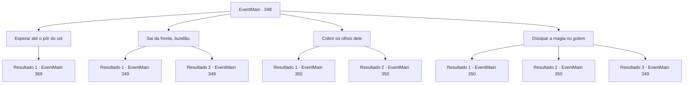

# Eventos principais · 348

[Índice da tabela](index.md) · [Índice geral](../index.md)

ID: `pt:EventMain:348` · Fonte: `EventMain4` · Versão: 1.2.47.

Mapeamento estático dos arquivos; a disponibilidade e a execução dependem do estado da run.

## Texto do evento

*Sem texto no arquivo.*

## Dados de entrada

```json
{
  "id": 348,
  "grade": 1,
  "normalGoal": "",
  "required": ""
}
```

## Mapa das escolhas



## Escolhas e resultados

### Escolha 1

Esperar até o pôr do sol

Requisitos e outros campos da escolha:

```json
{
  "required": ""
}
```

#### Resultado 1.1

Você decide esperar até o pôr do sol, como o golem disse. 

 Quando o sol está prestes a se pôr, uma onda de público enche a entrada do coliseu. Todo mundo está apostando no vencedor da partida de hoje. Parece que todos estão animados. Ao olhar em volta, você vê um zelador passando por um corredor vigiado com um cabo de vassoura na mão.

Continuação registrada: [Evento 369](0369.md) na mesma tabela.

```json
{
  "required": "",
  "chance": "1",
  "nextEvent": 369,
  "type": 2,
  "reward": ""
}
```

### Escolha 2

Sai da frente, bundão.

Requisitos e outros campos da escolha:

```json
{
  "required": "2_3_0"
}
```

#### Resultado 2.1

O golem parece insatisfeito com sua resposta. Ele se levanta lentamente, sua estatura se mostrando gigantesca, então joga seus punhos em você.

Continuação registrada: [Evento 349](0349.md) na mesma tabela.

```json
{
  "required": "18_256_1",
  "chance": "1",
  "nextEvent": 349,
  "type": 2,
  "reward": "6_0_15",
  "place": 4
}
```

#### Resultado 2.2

O golem parece insatisfeito com sua resposta. Ele se levanta lentamente, sua estatura se mostrando gigantesca, então joga seus punhos em você. Luan grita, assustado. 

 "Caramba! Todos nós vamos morrer assim!"

 Ele prepara sua maça, pegando-a de suas costas.

Continuação registrada: [Evento 349](0349.md) na mesma tabela.

```json
{
  "required": "5_256_1",
  "chance": "1",
  "nextEvent": 349,
  "type": 2,
  "reward": "6_2_15",
  "place": 4
}
```

### Escolha 3

Cobrir os olhos dele

Requisitos e outros campos da escolha:

```json
{
  "required": "1_14_11"
}
```

#### Resultado 3.1

Você procura ao redor, procurando algo para cobrir os olhos do golem. Você encontra um pedaço abandonado de pano preto. Você então o joga sobre a cabeça do golem. Quando o pedaço de pano cai no golem, ele retorna ao seu lugar e se agacha. Você então abre a porta do coliseu atrás dele.

Continuação registrada: [Evento 350](0350.md) na mesma tabela.

```json
{
  "required": "18_256_1",
  "chance": "1",
  "nextEvent": 350,
  "type": 2,
  "reward": "0_2_1"
}
```

#### Resultado 3.2

Você procura ao redor, procurando algo para cobrir os olhos do golem. Você encontra um pedaço abandonado de pano preto. Você então o joga sobre a cabeça do golem. Quando o pedaço de pano cai no golem, ele retorna ao seu lugar e se agacha. Você então abre a porta do coliseu atrás dela. Luan, depois de ver isso, aplaude com admiração. 

 "Uau... essa foi genial. Como você pensou nisso?"


Continuação registrada: [Evento 350](0350.md) na mesma tabela.

```json
{
  "required": "5_256_1",
  "chance": "1",
  "nextEvent": 350,
  "type": 2,
  "reward": "0_2_1"
}
```

### Escolha 4

Dissipar a magia no golem

Requisitos e outros campos da escolha:

```json
{
  "required": "20_0_1|1_1_2"
}
```

#### Resultado 4.1

Você percebe que há algum tipo de força magia alimentando o golem. Depois de dar um passo para trás, você se concentra e identifica a estrutura da magia ligada a esse golem. Você então lança um feitiço de dissipação simples para anular o feitiço lançado no golem. Você sente a magia desaparecendo da estrutura do golem. Você passa pelo golem e entra no coliseu.

Continuação registrada: [Evento 350](0350.md) na mesma tabela.

```json
{
  "required": "21_0_3",
  "chance": "1|0_7_1",
  "nextEvent": 350,
  "type": 0,
  "reward": "0_1_-1|0_2_1"
}
```

#### Resultado 4.2

Você percebe que há algum tipo de força magia alimentando o golem. Depois de dar um passo para trás, você facilmente quebra o feitiço com um simples gesto de suas mãos. Você sente a magia desaparecendo da estrutura do golem. Você passa pelo golem e entra no coliseu.

Continuação registrada: [Evento 350](0350.md) na mesma tabela.

```json
{
  "required": "20_0_3",
  "chance": "1",
  "nextEvent": 350,
  "type": 0,
  "reward": "0_1_-1|0_2_1"
}
```

#### Resultado 4.3

Você percebe que há algum tipo de força magia alimentando o golem. Depois de dar um passo para trás, você se concentra e identifica a estrutura da magia ligada a esse golem. Mas conforme você está dissipando o feitiço, você perde o foco e não consegue quebrar o feitiço. O golem percebe que você tentou algo com ele. Ele se levanta, expondo seu corpo gigante, e avança em sua direção.

Continuação registrada: [Evento 349](0349.md) na mesma tabela.

```json
{
  "required": "21_0_3",
  "chance": "15",
  "nextEvent": 349,
  "type": 1,
  "reward": "0_1_-1|6_0_15",
  "place": 4
}
```

## Referências que chegam a este evento

- [Evento 346 · escolha 3 · resultado 1](0346.md#escolha-3)
- [Evento 347 · escolha 3 · resultado 1](0347.md#escolha-3)
