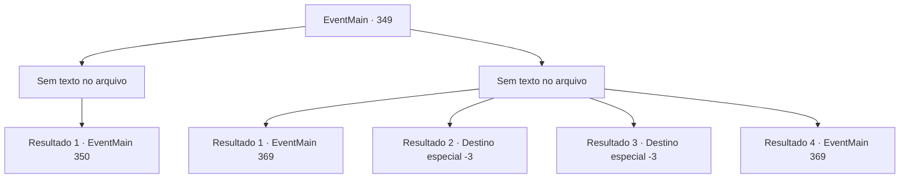

# Eventos principais · 349

[Índice da tabela](index.md) · [Índice geral](../index.md)

ID: `pt:EventMain:349` · Fonte: `EventMain4` · Versão: 1.2.47.

Mapeamento estático dos arquivos; a disponibilidade e a execução dependem do estado da run.

## Texto do evento

*Sem texto no arquivo.*

## Dados de entrada

```json
{
  "id": 349,
  "grade": 1,
  "normalGoal": "",
  "required": ""
}
```

## Mapa das escolhas



## Escolhas e resultados

### Escolha 1

*Sem texto no arquivo; o papel dessa opção depende da interface do jogo.*

Requisitos e outros campos da escolha:

```json
{
  "required": ""
}
```

#### Resultado 1.1

Você quebra o golem em pedaços. À medida que a poeira enche o ar, a porta do coliseu atrás do golem se abre.

Continuação registrada: [Evento 350](0350.md) na mesma tabela.

```json
{
  "required": "",
  "chance": "1",
  "nextEvent": 350,
  "type": 2,
  "reward": ""
}
```

### Escolha 2

*Sem texto no arquivo; o papel dessa opção depende da interface do jogo.*

Requisitos e outros campos da escolha:

```json
{
  "required": ""
}
```

#### Resultado 2.1

Você não tem escolha a não ser fugir. Conforme você ganha alguma distância, o golem retorna ao seu local. Infelizmente, você não tem escolha a não ser esperar até o pôr do sol. 

 Quando o sol está prestes a se pôr, uma onda de público enche a entrada do coliseu. Todo mundo está apostando no vencedor da partida de hoje. Parece que todos estão animados. Ao olhar em volta, você vê um zelador passando por um corredor vigiado com um cabo de vassoura na mão.

Continuação registrada: [Evento 369](0369.md) na mesma tabela.

```json
{
  "required": "18_256_1|1_0_2|1_1_2",
  "chance": "1",
  "nextEvent": 369,
  "type": 2,
  "reward": "0_0_-1|0_1_-1"
}
```

#### Resultado 2.2

Você é esmagado pelos punhos do golem.

Continuação registrada: [Destino especial `-3`](../destinos-especiais.md).

```json
{
  "required": "2_0_2",
  "chance": "1",
  "nextEvent": -3,
  "type": 2,
  "reward": "0_0_-1|0_1_-1"
}
```

#### Resultado 2.3

Você é esmagado pelos punhos do golem.

Continuação registrada: [Destino especial `-3`](../destinos-especiais.md).

```json
{
  "required": "2_1_2",
  "chance": "1",
  "nextEvent": -3,
  "type": 2,
  "reward": "0_0_-1|0_1_-1"
}
```

#### Resultado 2.4

Você e Luan não têm escolha a não ser fugir do golem. Conforme você ganha alguma distância, o golem retorna ao seu local. Luan resmunga. 

 "Viu... eu disse que deveríamos esperar... ufa..."

 Infelizmente, você não tem escolha a não ser esperar até o pôr do sol. 

 Quando o sol está prestes a se pôr, uma onda de público enche a entrada do coliseu. Todo mundo está apostando no vencedor da partida de hoje. Parece que todos estão animados. Ao olhar em volta, você vê um zelador passando por um corredor vigiado com um cabo de vassoura na mão.

Continuação registrada: [Evento 369](0369.md) na mesma tabela.

```json
{
  "required": "5_256_1|1_0_2|1_1_2",
  "chance": "1",
  "nextEvent": 369,
  "type": 2,
  "reward": "0_0_-1|0_1_-1"
}
```

## Referências que chegam a este evento

- [Evento 348 · escolha 2 · resultado 1](0348.md#escolha-2)
- [Evento 348 · escolha 2 · resultado 2](0348.md#escolha-2)
- [Evento 348 · escolha 4 · resultado 3](0348.md#escolha-4)
