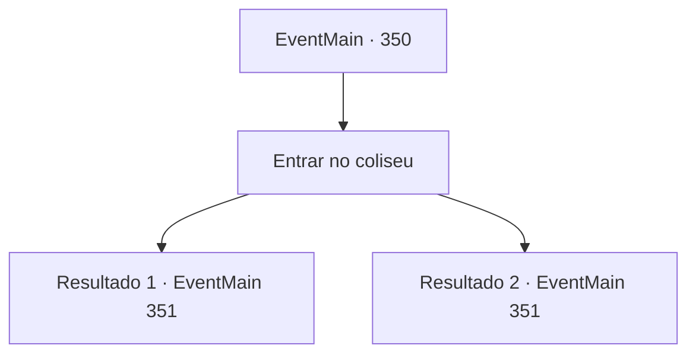

# Eventos principais · 350

[Índice da tabela](index.md) · [Índice geral](../index.md)

ID: `pt:EventMain:350` · Fonte: `EventMain4` · Versão: 1.2.47.

Mapeamento estático dos arquivos; a disponibilidade e a execução dependem do estado da run.

## Texto do evento

*Sem texto no arquivo.*

## Dados de entrada

```json
{
  "id": 350,
  "grade": 1,
  "normalGoal": "",
  "required": ""
}
```

## Mapa das escolhas



## Escolhas e resultados

### Escolha 1

Entrar no coliseu

Requisitos e outros campos da escolha:

```json
{
  "required": ""
}
```

#### Resultado 1.1

Você vagueia pelo coliseu. O coliseu está completamente vazio, com nada além dos raios do sol enchendo o ar. Logo, você encontra outra entrada que leva ao subsolo. Parece um lugar destinado aos participantes e feras, em vez do público. Você entra na entrada, descendo as escadas. |drawing_lomhnePrison| Você chega a uma grande cavidade. Uma enorme gaiola de aço o separa do lado em que você está. Você vê um guarda sentado na frente da jaula. Ainda não é noite, mas o guarda está cochilando.

Continuação registrada: [Evento 351](0351.md) na mesma tabela.

```json
{
  "required": "18_256_1",
  "chance": "1",
  "nextEvent": 351,
  "type": 2,
  "reward": ""
}
```

#### Resultado 1.2

Você e Luan passeiam pelo coliseu. O coliseu está completamente vazio, com nada além dos raios do sol enchendo o ar. Logo, você encontra outra entrada que leva ao subsolo. Parece um lugar destinado aos participantes e feras, em vez do público. Você entra na entrada, descendo as escadas. |drawing_lomhnePrison| Você chega a uma grande cavidade. Uma enorme gaiola de aço o separa do lado em que você está. Você vê um guarda sentado na frente da jaula. Ainda não é noite, mas o guarda está cochilando. Luan sussurra para você, seus olhos brilhando com confiança. 

 "...Eu tenho uma ideia. Pode deixar comigo."


Continuação registrada: [Evento 351](0351.md) na mesma tabela.

```json
{
  "required": "5_256_1",
  "chance": "1",
  "nextEvent": 351,
  "type": 2,
  "reward": ""
}
```

## Referências que chegam a este evento

- [Evento 348 · escolha 3 · resultado 1](0348.md#escolha-3)
- [Evento 348 · escolha 3 · resultado 2](0348.md#escolha-3)
- [Evento 348 · escolha 4 · resultado 1](0348.md#escolha-4)
- [Evento 348 · escolha 4 · resultado 2](0348.md#escolha-4)
- [Evento 349 · escolha 1 · resultado 1](0349.md#escolha-1)
