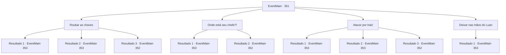

# Eventos principais · 351

[Índice da tabela](index.md) · [Índice geral](../index.md)

ID: `pt:EventMain:351` · Fonte: `EventMain4` · Versão: 1.2.47.

Mapeamento estático dos arquivos; a disponibilidade e a execução dependem do estado da run.

## Texto do evento

*Sem texto no arquivo.*

## Dados de entrada

```json
{
  "id": 351,
  "grade": 1,
  "normalGoal": "",
  "required": ""
}
```

## Mapa das escolhas



## Escolhas e resultados

### Escolha 1

Roubar as chaves

Requisitos e outros campos da escolha:

```json
{
  "required": ""
}
```

#### Resultado 1.1

O guarda nem percebe que você roubou as chaves dele e abriu a porta da jaula. Você passa pela jaula de aço, entrando na prisão subterrânea. A prisão está cheia de celas de pedra, separadas por portas de ferro. Você sente olhares humanos saindo dos pequenos espaços entre as gaiolas. As células são destinadas a uma pessoa cada. Na frente de cada porta está o nome do preso. Você anda com cuidado e finalmente encontra a porta com o nome 'Fiana' escrito nela.

Continuação registrada: [Evento 353](0353.md) na mesma tabela.

```json
{
  "required": "21_5_1",
  "chance": "1|0_6_1",
  "nextEvent": 353,
  "type": 0,
  "reward": ""
}
```

#### Resultado 1.2

O diretor nem percebe que você roubou as chaves dele e abriu a porta da jaula. Você passa pela jaula de aço, entrando na prisão subterrânea. A prisão está cheia de celas de pedra, separadas por portas de ferro. Você sente olhares humanos saindo dos pequenos espaços entre as gaiolas. As células são destinadas a uma pessoa cada. Na frente de cada porta está o nome do preso. Você anda com cuidado e finalmente encontra a porta com o nome 'Fiana' escrito nela.

Continuação registrada: [Evento 353](0353.md) na mesma tabela.

```json
{
  "required": "20_5_1",
  "chance": "1|0_6_1",
  "nextEvent": 353,
  "type": 0,
  "reward": ""
}
```

#### Resultado 1.3

Enquanto você está tentando arrancar as chaves do diretor, ele se levanta, assustado. Ele então ataca você com sua arma, seus olhos queimando de raiva.

Continuação registrada: [Evento 352](0352.md) na mesma tabela.

```json
{
  "required": "",
  "chance": "18",
  "nextEvent": 352,
  "type": 1,
  "reward": "6_0_19",
  "place": 7
}
```

### Escolha 2

Onde está seu chefe?!

Requisitos e outros campos da escolha:

```json
{
  "required": ""
}
```

#### Resultado 2.1

Você orgulhosamente fica na frente do diretor e faz um barulho alto para acordá-lo. Você critica sua atitude preguiçosa no trabalho, perguntando onde está seu chefe. O diretor lhe responde, atônito. 

 "Uh...hm... Qual é a sua relação com o chefe Anton, posso saber...?"

 Você diz que ele e você são melhores amigos de infância. Você ordena que ele abra a porta rapidamente. Mesmo assim, ele abre a porta da jaula de aço, ainda surpreso com a visita inesperada. Você passa pela jaula de aço, entrando na prisão subterrânea. A prisão está cheia de celas de pedra, separadas por portas de ferro. Você sente olhares humanos saindo dos pequenos espaços entre as gaiolas. As células são destinadas a uma pessoa cada. Na frente de cada porta está o nome do preso. Você anda com cuidado e finalmente encontra a porta com o nome 'Fiana' escrito nela.

Continuação registrada: [Evento 353](0353.md) na mesma tabela.

```json
{
  "required": "",
  "chance": "1|0_12_1",
  "nextEvent": 353,
  "type": 0,
  "reward": ""
}
```

#### Resultado 2.2

Você orgulhosamente fica na frente do diretor e faz um barulho alto para acordá-lo. Você critica sua atitude preguiçosa no trabalho, perguntando onde está seu chefe. Mas você vacila. Ele não está nem um pouco convencido. 

 "Pare de brincar!"

 O diretor ataca você com sua arma, seus olhos ardendo de raiva. 

Continuação registrada: [Evento 352](0352.md) na mesma tabela.

```json
{
  "required": "",
  "chance": "13",
  "nextEvent": 352,
  "type": 1,
  "reward": "6_0_19",
  "place": 7
}
```

### Escolha 3

Atacar por trás!

Requisitos e outros campos da escolha:

```json
{
  "required": ""
}
```

#### Resultado 3.1

Você se aproxima rapidamente do diretor adormecido. Ele não está ciente de sua presença em tudo. Você cortou o pescoço dele em um piscar de olhos. Ele se dissipa no ar como uma névoa, e você abre a porta da jaula de aço e entra na prisão. A prisão está cheia de celas de pedra, separadas por portas de ferro. Você sente olhares humanos saindo dos pequenos espaços entre as gaiolas. As células são destinadas a uma pessoa cada. Na frente de cada porta está o nome do preso. Você anda com cuidado e finalmente encontra a porta com o nome 'Fiana' escrito nela.

Continuação registrada: [Evento 353](0353.md) na mesma tabela.

```json
{
  "required": "21_5_2",
  "chance": "1|0_6_1",
  "nextEvent": 353,
  "type": 0,
  "reward": ""
}
```

#### Resultado 3.2

Você se aproxima rapidamente do diretor adormecido. Ele não está ciente de sua presença em tudo. Você cortou o pescoço dele em um piscar de olhos. Ele se dissipa no ar como névoa. Você coloca seus restos dentro de um barril de madeira próximo e abre a porta da gaiola de aço, entrando na prisão subterrânea. A prisão está cheia de celas de pedra, separadas por portas de ferro. Você sente olhares humanos saindo dos pequenos espaços entre as gaiolas. As células são destinadas a uma pessoa cada. Na frente de cada porta está o nome do preso. Você anda com cuidado e finalmente encontra a porta com o nome 'Fiana' escrito nela.

Continuação registrada: [Evento 353](0353.md) na mesma tabela.

```json
{
  "required": "20_5_2",
  "chance": "1|0_6_2",
  "nextEvent": 353,
  "type": 0,
  "reward": ""
}
```

#### Resultado 3.3

Você se aproxima rapidamente do diretor adormecido. Mas ele sente sua presença e acorda. 

 "O que... que diabos!"

 O guarda ataca você com sua arma, seus olhos ardendo de raiva.

Continuação registrada: [Evento 352](0352.md) na mesma tabela.

```json
{
  "required": "",
  "chance": "15",
  "nextEvent": 352,
  "type": 1,
  "reward": "6_0_19",
  "place": 7
}
```

### Escolha 4

Deixar nas mãos do Luan

Requisitos e outros campos da escolha:

```json
{
  "required": "5_256_1"
}
```

#### Resultado 4.1

Você vira a cabeça para Luan e acena com a cabeça. Luan acena com a cabeça em resposta, então puxa um caco de espelho, virando-o para o diretor. Nenhuma reflexão é criada no fragmento do espelho. Assim que vê isso, Luan joga um dardo de prata no diretor. 

 "Aq...?! O que..??"

 O dardo mágico de prata perfura o pescoço do diretor. Ele dá uma olhada em seu pescoço e cai. Seu corpo começa a queimar, a partir de seu pescoço, e se transforma em uma pilha de cinzas. 

 "Como eu esperava. Um vampiro."

 Luan limpa as cinzas de suas roupas e gesticula para você. Ele então abre a porta da gaiola de aço. Você atravessa a porta da gaiola de aço e entra na prisão subterrânea. A prisão está cheia de celas de pedra, separadas por portas de ferro. Você sente olhares humanos saindo dos pequenos espaços entre as gaiolas. As células são destinadas a uma pessoa cada. Na frente de cada porta está o nome do preso. Você anda com cuidado e finalmente encontra a porta com o nome 'Fiana' escrito nela. 

Continuação registrada: [Evento 353](0353.md) na mesma tabela.

```json
{
  "required": "",
  "chance": "1",
  "nextEvent": 353,
  "type": 2,
  "reward": ""
}
```

## Referências que chegam a este evento

- [Evento 350 · escolha 1 · resultado 1](0350.md#escolha-1)
- [Evento 350 · escolha 1 · resultado 2](0350.md#escolha-1)
