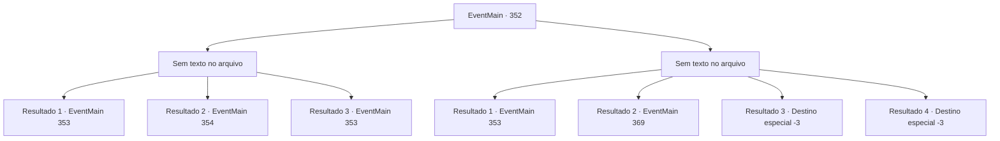

# Eventos principais · 352

[Índice da tabela](index.md) · [Índice geral](../index.md)

ID: `pt:EventMain:352` · Fonte: `EventMain4` · Versão: 1.2.47.

Mapeamento estático dos arquivos; a disponibilidade e a execução dependem do estado da run.

## Texto do evento

*Sem texto no arquivo.*

## Dados de entrada

```json
{
  "id": 352,
  "grade": 1,
  "normalGoal": "",
  "required": ""
}
```

## Mapa das escolhas



## Escolhas e resultados

### Escolha 1

*Sem texto no arquivo; o papel dessa opção depende da interface do jogo.*

Requisitos e outros campos da escolha:

```json
{
  "required": ""
}
```

#### Resultado 1.1

O diretor derrotado se transforma em uma pilha de cinzas, deixando para trás as chaves. Você atravessa a porta da gaiola de aço e entra na prisão subterrânea. A prisão está cheia de celas de pedra, separadas por portas de ferro. Você sente olhares humanos saindo dos pequenos espaços entre as gaiolas. As células são destinadas a uma pessoa cada. Na frente de cada porta está o nome do preso. Você anda com cuidado e finalmente encontra a porta com o nome 'Fiana' escrito nela. 

Continuação registrada: [Evento 353](0353.md) na mesma tabela.

```json
{
  "required": "23_2_1",
  "chance": "1",
  "nextEvent": 353,
  "type": 2,
  "reward": ""
}
```

#### Resultado 1.2

Você derrota o diretor, mas seu corpo se contorce e depois se levanta. Ele é um vampiro. Ele caminha em sua direção novamente, balançando os braços de maneira grotesca.

Continuação registrada: [Evento 354](0354.md) na mesma tabela.

```json
{
  "required": "24_2_1|18_256_1",
  "chance": "1",
  "nextEvent": 354,
  "type": 2,
  "reward": "6_2_19",
  "place": 7
}
```

#### Resultado 1.3

Você derrota o diretor, mas seu corpo se contorce e depois se levanta. Ele é um vampiro. Então, um dardo mágico de prata perfura o pescoço do diretor. Ele dá uma olhada em seu pescoço e cai. Seu corpo começa a queimar, a partir de seu pescoço, e se transforma em uma pilha de cinzas. 

 "Como eu esperava. Um vampiro."

 Luan limpa as cinzas de suas roupas e gesticula para você. Ele então abre a porta da gaiola de aço. Você atravessa a porta da gaiola de aço e entra na prisão subterrânea. A prisão está cheia de celas de pedra, separadas por portas de ferro. Você sente olhares humanos saindo dos pequenos espaços entre as gaiolas. As células são destinadas a uma pessoa cada. Na frente de cada porta está o nome do preso. Você anda com cuidado e finalmente encontra a porta com o nome 'Fiana' escrito nela.

Continuação registrada: [Evento 353](0353.md) na mesma tabela.

```json
{
  "required": "24_2_1|5_256_1",
  "chance": "1",
  "nextEvent": 353,
  "type": 2,
  "reward": ""
}
```

### Escolha 2

*Sem texto no arquivo; o papel dessa opção depende da interface do jogo.*

Requisitos e outros campos da escolha:

```json
{
  "required": ""
}
```

#### Resultado 2.1

As garras afiadas do diretor são lançadas em direção ao seu coração. Então, um dardo mágico de prata perfura o pescoço do diretor. Ele tateia o ferimento no pescoço, confuso, e cai logo em seguida. Seu corpo começa a queimar, a partir de seu pescoço, e se transforma em uma pilha de cinzas. 

 "Como eu esperava. Um vampiro."

 Luan limpa as cinzas de suas roupas e gesticula para você. Ele então abre a porta da gaiola de aço. Você atravessa a porta da gaiola de aço e entra na prisão subterrânea. A prisão está cheia de celas de pedra, separadas por portas de ferro. Você sente olhares humanos saindo dos pequenos espaços entre as gaiolas. As células são destinadas a uma pessoa cada. Na frente de cada porta está o nome do preso. Você anda com cuidado e finalmente encontra a porta com o nome 'Fiana' escrito nela.

Continuação registrada: [Evento 353](0353.md) na mesma tabela.

```json
{
  "required": "5_256_1|1_0_2|1_1_2",
  "chance": "1",
  "nextEvent": 353,
  "type": 2,
  "reward": "0_0_-1|0_1_-1"
}
```

#### Resultado 2.2

Você não consegue derrotar o vampiro e corre para fora. O sol ainda está lá fora, então o diretor não o persegue mais. Depois de correr para fora do coliseu, você não tem outra opção a não ser esperar até o pôr do sol. 

 Quando o sol está prestes a se pôr, uma onda de público enche a entrada do coliseu. Todo mundo está apostando no vencedor da partida de hoje. Parece que todos estão animados. Ao olhar em volta, você vê um zelador passando por um corredor vigiado com um cabo de vassoura na mão.

Continuação registrada: [Evento 369](0369.md) na mesma tabela.

```json
{
  "required": "18_256_1|1_0_2|1_1_2",
  "chance": "1",
  "nextEvent": 369,
  "type": 2,
  "reward": "0_0_-1|0_1_-1"
}
```

#### Resultado 2.3

O diretor revela suas presas afiadas, mordendo sua garganta. Com sangue jorrando do pescoço, você perde a consciência.

Continuação registrada: [Destino especial `-3`](../destinos-especiais.md).

```json
{
  "required": "2_0_2",
  "chance": "1",
  "nextEvent": -3,
  "type": 2,
  "reward": "0_0_-1|0_1_-1"
}
```

#### Resultado 2.4

O diretor revela suas presas afiadas, mordendo sua garganta. Com sangue jorrando do pescoço, você perde a consciência.

Continuação registrada: [Destino especial `-3`](../destinos-especiais.md).

```json
{
  "required": "2_1_2",
  "chance": "1",
  "nextEvent": -3,
  "type": 2,
  "reward": "0_0_-1|0_1_-1"
}
```

## Referências que chegam a este evento

- [Evento 351 · escolha 1 · resultado 3](0351.md#escolha-1)
- [Evento 351 · escolha 2 · resultado 2](0351.md#escolha-2)
- [Evento 351 · escolha 3 · resultado 3](0351.md#escolha-3)
