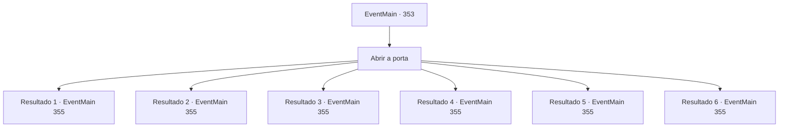

# Eventos principais · 353

[Índice da tabela](index.md) · [Índice geral](../index.md)

ID: `pt:EventMain:353` · Fonte: `EventMain4` · Versão: 1.2.47.

Mapeamento estático dos arquivos; a disponibilidade e a execução dependem do estado da run.

## Texto do evento

*Sem texto no arquivo.*

## Dados de entrada

```json
{
  "id": 353,
  "grade": 1,
  "normalGoal": "",
  "required": ""
}
```

## Mapa das escolhas



## Escolhas e resultados

### Escolha 1

Abrir a porta

Requisitos e outros campos da escolha:

```json
{
  "required": ""
}
```

#### Resultado 1.1

Você abre a porta da cela. A cela só tem largura suficiente para acomodar duas pessoas, no máximo. E lá está ela, sua irmãzinha, 'Fiana'. |drawing_meetSis| Você abraça sua irmã com força. Ela parece desnutrida, mas ficou mais alta desde a última vez que a viu. 

 "Irmão..! Senti a sua falta. Muito mesmo. Vamos sair daqui... cada moeda que eu gasto aqui é adicionada à nossa dívida. Quer eu beba uma poção ou compre uma lâmina, é tudo a mesma coisa. Se eu ficar aqui, nunca poderemos pagar nossa dívida."


Continuação registrada: [Evento 355](0355.md) na mesma tabela.

```json
{
  "required": "5_244_0|11_0_0",
  "chance": "1",
  "nextEvent": 355,
  "type": 2,
  "reward": "0_1_1"
}
```

#### Resultado 1.2

Você abre a porta da cela. A cela só tem largura suficiente para acomodar duas pessoas, no máximo. E lá está ela, sua irmãzinha, 'Fiana'. |drawing_meetSis| Você abraça sua irmã com força. Ela parece desnutrida, mas ficou mais alta desde a última vez que a viu. 

 "Irmã..! Senti a sua falta. Muito mesmo. Vamos sair daqui... cada moeda que eu gasto aqui é adicionada à nossa dívida. Quer eu beba uma poção ou compre uma lâmina, é tudo a mesma coisa. Se eu ficar aqui, nunca poderemos pagar nossa dívida."


Continuação registrada: [Evento 355](0355.md) na mesma tabela.

```json
{
  "required": "5_244_0|11_0_1",
  "chance": "1",
  "nextEvent": 355,
  "type": 2,
  "reward": "0_1_1"
}
```

#### Resultado 1.3

Você abre a porta da cela. A cela só tem largura suficiente para acomodar duas pessoas, no máximo. E lá está ela, sua irmãzinha, 'Fiana'. |drawing_meetSis| Você abraça sua irmã com força. Ela parece desnutrida, mas ficou mais alta desde a última vez que a viu. 

 "Irmã..! Senti a sua falta. Muito mesmo. Vamos sair daqui... cada moeda que eu gasto aqui é adicionada à nossa dívida. Quer eu beba uma poção ou compre uma lâmina, é tudo a mesma coisa. Se eu ficar aqui, nunca poderemos pagar nossa dívida."


Continuação registrada: [Evento 355](0355.md) na mesma tabela.

```json
{
  "required": "5_244_1|11_0_0",
  "chance": "1",
  "nextEvent": 355,
  "type": 2,
  "reward": "0_1_1"
}
```

#### Resultado 1.4

Você abre a porta da cela. A cela só tem largura suficiente para acomodar duas pessoas, no máximo. E lá está ela, sua irmãzinha, 'Fiana'. |drawing_meetSis| Você abraça sua irmã com força. Ela ganhou muitos músculos desde a última vez que a viu. Provavelmente de todas as lutas que ela passou. 

 "Irmã..! Senti a sua falta. Muito mesmo. Vamos sair daqui... cada moeda que eu gasto aqui é adicionada à nossa dívida. Quer eu beba uma poção ou compre uma lâmina, é tudo a mesma coisa. Se eu ficar aqui, nunca poderemos pagar nossa dívida."


Continuação registrada: [Evento 355](0355.md) na mesma tabela.

```json
{
  "required": "5_244_1|11_0_1",
  "chance": "1",
  "nextEvent": 355,
  "type": 2,
  "reward": "0_1_1"
}
```

#### Resultado 1.5

Você abre a porta da cela. A cela só tem largura suficiente para acomodar duas pessoas, no máximo. E lá está ela, sua irmãzinha, 'Fiana'. |drawing_meetSis| Você abraça sua irmã com força. Seu corpo está coberto de hematomas e cortes, provavelmente de todas as lutas que ela passou, mas por outro lado, ganhou uma enorme quantidade de músculos desde a última vez que se viram. 

 "Onde diabos você estava?! Vocę sabe o quanto eu... arh, deixa pra lá. Vamos sair daqui primeiro... cada moeda que gasto aqui é adicionada à nossa dívida. Quer eu beba uma poção ou compre uma lâmina, é tudo a mesma coisa. Se eu ficar aqui, nunca poderemos pagar nossa dívida."


Continuação registrada: [Evento 355](0355.md) na mesma tabela.

```json
{
  "required": "5_244_2|11_0_0",
  "chance": "1",
  "nextEvent": 355,
  "type": 2,
  "reward": "0_1_1"
}
```

#### Resultado 1.6

Você abre a porta da cela. A cela só tem largura suficiente para acomodar duas pessoas, no máximo. E lá está ela, sua irmãzinha, 'Fiana'. |drawing_meetSis| Você abraça sua irmã com força. Seu corpo está coberto de hematomas e cortes, provavelmente de todas as lutas que ela passou, mas por outro lado, ganhou uma enorme quantidade de músculos desde a última vez que se viram. 

 "Onde diabos você estava?! Vocę sabe o quanto eu... arh, deixa pra lá. Vamos sair daqui primeiro... cada moeda que gasto aqui é adicionada à nossa dívida. Quer eu beba uma poção ou compre uma lâmina, é tudo a mesma coisa. Se eu ficar aqui, nunca poderemos pagar nossa dívida."


Continuação registrada: [Evento 355](0355.md) na mesma tabela.

```json
{
  "required": "5_244_2|11_0_1",
  "chance": "1",
  "nextEvent": 355,
  "type": 2,
  "reward": "0_1_1"
}
```

## Referências que chegam a este evento

- [Evento 351 · escolha 1 · resultado 1](0351.md#escolha-1)
- [Evento 351 · escolha 1 · resultado 2](0351.md#escolha-1)
- [Evento 351 · escolha 2 · resultado 1](0351.md#escolha-2)
- [Evento 351 · escolha 3 · resultado 1](0351.md#escolha-3)
- [Evento 351 · escolha 3 · resultado 2](0351.md#escolha-3)
- [Evento 351 · escolha 4 · resultado 1](0351.md#escolha-4)
- [Evento 352 · escolha 1 · resultado 1](0352.md#escolha-1)
- [Evento 352 · escolha 1 · resultado 3](0352.md#escolha-1)
- [Evento 352 · escolha 2 · resultado 1](0352.md#escolha-2)
- [Evento 354 · escolha 1 · resultado 1](0354.md#escolha-1)
- [Evento 369 · escolha 1 · resultado 1](0369.md#escolha-1)
- [Evento 369 · escolha 2 · resultado 1](0369.md#escolha-2)
- [Evento 369 · escolha 2 · resultado 3](0369.md#escolha-2)
- [Evento 370 · escolha 1 · resultado 1](0370.md#escolha-1)
- [Evento 370 · escolha 1 · resultado 2](0370.md#escolha-1)
- [Evento 370 · escolha 2 · resultado 2](0370.md#escolha-2)
- [Evento 371 · escolha 1 · resultado 1](0371.md#escolha-1)
