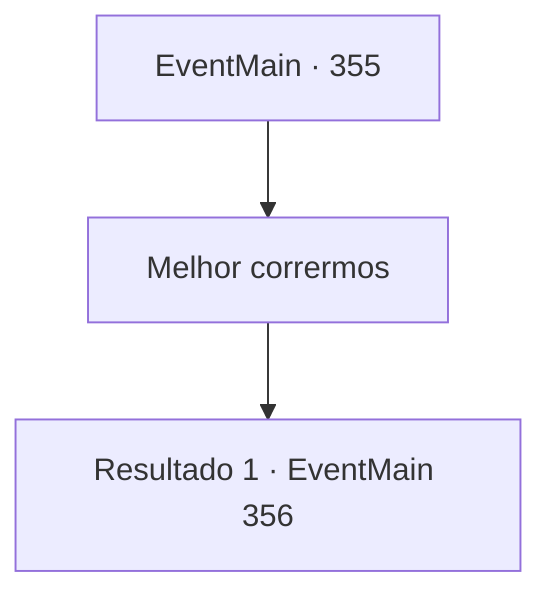

# Eventos principais · 355

[Índice da tabela](index.md) · [Índice geral](../index.md)

ID: `pt:EventMain:355` · Fonte: `EventMain4` · Versão: 1.2.47.

Mapeamento estático dos arquivos; a disponibilidade e a execução dependem do estado da run.

## Texto do evento

*Sem texto no arquivo.*

## Dados de entrada

```json
{
  "id": 355,
  "grade": 1,
  "normalGoal": "",
  "required": ""
}
```

## Mapa das escolhas



## Escolhas e resultados

### Escolha 1

Melhor corrermos

Requisitos e outros campos da escolha:

```json
{
  "required": ""
}
```

#### Resultado 1.1

Depois de ouvir você, ela lhe diz que pensou em um plano. 

 "Espere... Mesmo se fugíssemos, quero libertar todas essas pessoas."

 Depois de hesitar brevemente, Fiana sorri e continua. 

 "Ou, podemos simplesmente nos livrar daquele que tem nos caçado."


Continuação registrada: [Evento 356](0356.md) na mesma tabela.

```json
{
  "required": "",
  "chance": "1",
  "nextEvent": 356,
  "type": 2,
  "reward": ""
}
```

## Referências que chegam a este evento

- [Evento 353 · escolha 1 · resultado 1](0353.md#escolha-1)
- [Evento 353 · escolha 1 · resultado 2](0353.md#escolha-1)
- [Evento 353 · escolha 1 · resultado 3](0353.md#escolha-1)
- [Evento 353 · escolha 1 · resultado 4](0353.md#escolha-1)
- [Evento 353 · escolha 1 · resultado 5](0353.md#escolha-1)
- [Evento 353 · escolha 1 · resultado 6](0353.md#escolha-1)
