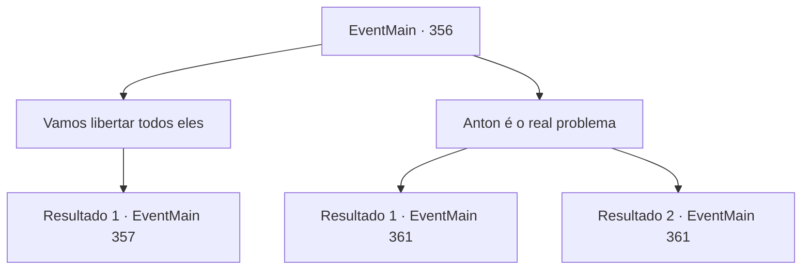

# Eventos principais · 356

[Índice da tabela](index.md) · [Índice geral](../index.md)

ID: `pt:EventMain:356` · Fonte: `EventMain4` · Versão: 1.2.47.

Mapeamento estático dos arquivos; a disponibilidade e a execução dependem do estado da run.

## Texto do evento

*Sem texto no arquivo.*

## Dados de entrada

```json
{
  "id": 356,
  "grade": 1,
  "normalGoal": "",
  "required": ""
}
```

## Mapa das escolhas



## Escolhas e resultados

### Escolha 1

Vamos libertar todos eles

Requisitos e outros campos da escolha:

```json
{
  "required": ""
}
```

#### Resultado 1.1

Fiana acena com a cabeça e se levanta. Ela então começa a abrir as portas de outras celas da prisão. As pessoas dentro das celas saem de suas jaulas, estupefatas. Fiana grita com eles, reunindo-os. 

 "Pessoas! Imagino que a maioria de vocês já tenha notado, certo? Quanto mais ficamos aqui, maiores ficam as nossas dívidas! Vamos viver como seus brinquedos até a nossa morte? OU VAMOS MOSTRAR DO QUE SOMOS FEITOS?!"

 As pessoas começam a murmurar depois de ouvir o discurso de Fiana. Então, os guardas aparecem e gritam. 

 "Volte para suas gaiolas imediatamente! Caso contrário, suas dívidas serão DOBRADAS!"

 Mas essa intimidação transformou os murmúrios em gritos. As pessoas enfurecidas começam a atacar os guardas, e logo a prisão está cheia de gritos sangrentos. Todos os guardas são vampiros. Com garras e presas afiadas, eles atacam os prisioneiros impiedosamente. Observando a cena se desenrolar, Fiana rapidamente fala com você. 

 "Nós... temos que lutar com eles...!"


Continuação registrada: [Evento 357](0357.md) na mesma tabela.

```json
{
  "required": "",
  "chance": "1",
  "nextEvent": 357,
  "type": 2,
  "reward": ""
}
```

### Escolha 2

Anton é o real problema

Requisitos e outros campos da escolha:

```json
{
  "required": ""
}
```

#### Resultado 2.1

Você acha que é melhor se livrar da raiz de todos esses problemas. Fiana acena com a cabeça em resposta. 

 "O escritório de Anton deve ser nas partes mais profundas do porão. Nós nos livramos de Anton... e essa vida infernal também deveria acabar. Vamos lá."

 Então você desce para o porão mais profundo com Fiana. Depois de descer as escadas encharcadas até o porão, um longo corredor aparece diante de você. Apenas iluminado por tochas distantes, o corredor é adornado com uma variedade de esculturas e decorações. O chão é coberto por um longo tapete vermelho. No final do corredor há uma porta lindamente decorada com ouro e cobre, guardada por dois porteiros. O corredor cheira levemente a sangue humano. 

Continuação registrada: [Evento 361](0361.md) na mesma tabela.

```json
{
  "required": "18_256_1",
  "chance": "1",
  "nextEvent": 361,
  "type": 2,
  "reward": ""
}
```

#### Resultado 2.2

Você acha que é melhor se livrar da raiz de todos esses problemas. Fiana acena com a cabeça em resposta. 

 "O escritório de Anton deve ser nas partes mais profundas do porão. Nós nos livramos de Anton... e essa vida infernal também deveria acabar. Vamos lá."

 Luan concorda e continua. 

 "Parece que esses vampiros não conseguiam o suficiente apenas sugando sangue. Este tipo de exploração... é inaceitável. Eu vou ajudar vocês dois."

 Então você desce para o porão mais profundo com Fiana e Luan. Depois de descer as escadas encharcadas até o porão, um longo corredor aparece diante de você. Apenas iluminado por tochas distantes, o corredor é adornado com uma variedade de esculturas e decorações. O chão é coberto por um longo tapete vermelho. No final do corredor há uma porta lindamente decorada com ouro e cobre, guardada por dois porteiros. O corredor cheira levemente a sangue humano. 

Continuação registrada: [Evento 361](0361.md) na mesma tabela.

```json
{
  "required": "5_256_1",
  "chance": "1",
  "nextEvent": 361,
  "type": 2,
  "reward": ""
}
```

## Referências que chegam a este evento

- [Evento 355 · escolha 1 · resultado 1](0355.md#escolha-1)
