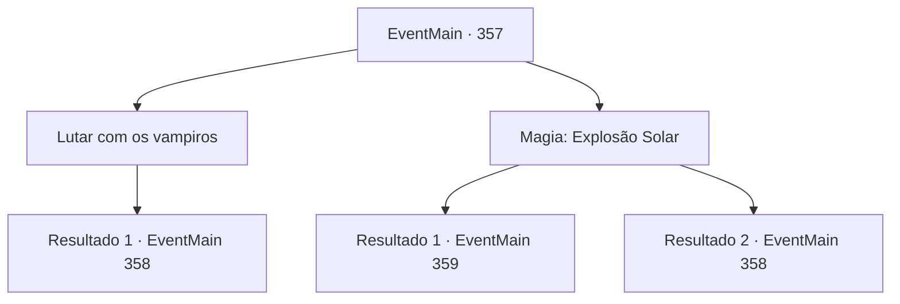

# Eventos principais · 357

[Índice da tabela](index.md) · [Índice geral](../index.md)

ID: `pt:EventMain:357` · Fonte: `EventMain4` · Versão: 1.2.47.

Mapeamento estático dos arquivos; a disponibilidade e a execução dependem do estado da run.

## Texto do evento

*Sem texto no arquivo.*

## Dados de entrada

```json
{
  "id": 357,
  "grade": 1,
  "normalGoal": "",
  "required": ""
}
```

## Mapa das escolhas



## Escolhas e resultados

### Escolha 1

Lutar com os vampiros

Requisitos e outros campos da escolha:

```json
{
  "required": ""
}
```

#### Resultado 1.1

Você prepara sua arma e começa a luta contra os vampiros. Fiana pega um pedaço de madeira do chão e se junta à luta também.

Continuação registrada: [Evento 358](0358.md) na mesma tabela.

```json
{
  "required": "",
  "chance": "1",
  "nextEvent": 358,
  "type": 2,
  "reward": "6_0_19",
  "place": 7
}
```

### Escolha 2

Magia: Explosão Solar

Requisitos e outros campos da escolha:

```json
{
  "required": "20_0_4|1_1_2"
}
```

#### Resultado 2.1

No meio de todo o caos, você consegue se concentrar e lançar um feitiço que imita a luz do sol. Uma explosão de luz brilhante sai do seu selo mágico. Os vampiros são transformados em pilhas de cinzas. Então, Anton aparece de repente, e ao pusar os olhos em você solta um berro. <link=shake>

 "V...VOCÊ..! SEU LIXO INGRATO...!!"

</link> Ele empurra os humanos próximos e avança em sua direção.

Continuação registrada: [Evento 359](0359.md) na mesma tabela.

```json
{
  "required": "",
  "chance": "1|0_14_1",
  "nextEvent": 359,
  "type": 0,
  "reward": "0_1_-1|6_0_125",
  "place": 7
}
```

#### Resultado 2.2

Você faz o seu melhor para imitar a luz do sol com sua magia, mas falha. Infelizmente, você busca outras soluções. Enquanto você prepara sua arma, Fiana pega um pedaço de madeira do chão também.

Continuação registrada: [Evento 358](0358.md) na mesma tabela.

```json
{
  "required": "",
  "chance": "13",
  "nextEvent": 358,
  "type": 1,
  "reward": "6_0_19|0_1_-1",
  "place": 7
}
```

## Referências que chegam a este evento

- [Evento 356 · escolha 1 · resultado 1](0356.md#escolha-1)
